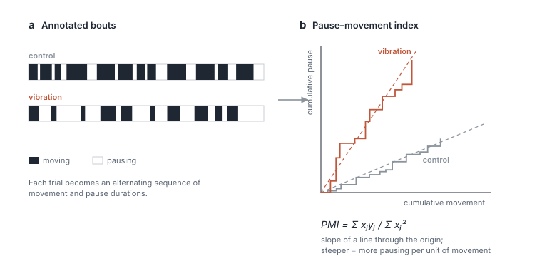

This is relevant to a study of whether ghost crabs sense the vibrations of prey buried in sand. The team built an arena with four buried actuators that reproduce prey-like pulses, filmed crabs before, during and after vibration, and compared them with control trials. The manuscript is under review (*Scientific Reports*).

My contribution was a way to measure the response. In the videos, affected crabs visibly froze, but distance and speed did not capture it, because crab locomotion alternates between moving and stopping. I proposed the pause–movement index: annotated bouts are accumulated into a curve of total pausing against total moving, and its slope gives how much a crab pauses per unit of movement. I built the pipeline that computes it; the team ran the statistics. It was the measure that separated vibration-exposed crabs from controls.