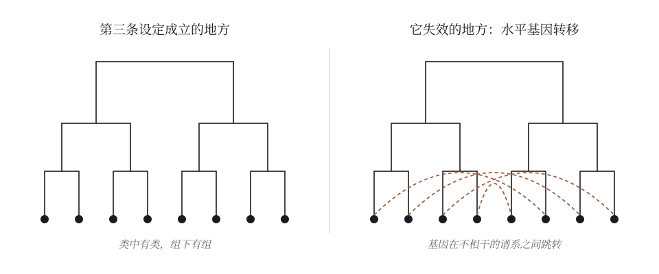
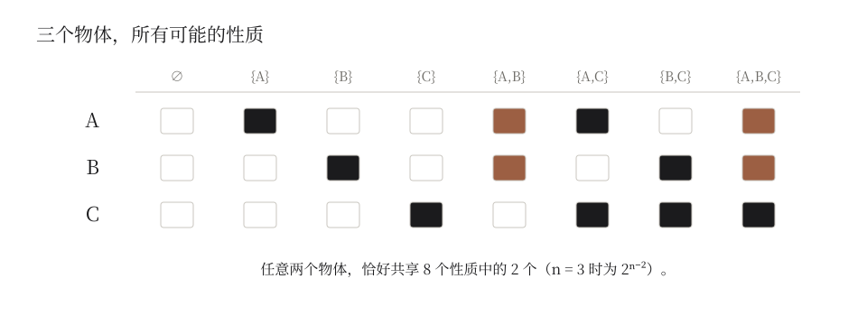

> 许多难题的出路，在于重新思考如何分类。

## 上篇 分类作为认知的手段

### 一、引言：从物种分类出发

肺鱼和你的亲缘关系，比它和金枪鱼更近。按照今天系统学的标准，"鱼"根本不是一个真正的类群。可林奈当年为了装下鱼而画的那棵树，至今还立着：从他那时到现在，树枝几乎全被重接了一遍，树的形状却留了下来。

这篇文章就从这件小事讲起。它发生在生物学里，但故事里藏着的那个结构，远比生物学要普遍。

[林奈](https://zh.wikipedia.org/wiki/%E5%8D%A1%E5%B0%94%C2%B7%E6%9E%97%E5%A5%88)（Carl Linnaeus）开创了系统地给物种分类的工作。1735 年，他发表了《自然系统》。那时他没有用显微镜观察细胞，更不知道 DNA 的存在，只凭"花蕊的数目和排列"这样的形态观察，把相似的生物归进同一个类别，再在这个类别里，把存在差异的物种进一步细分，如同一棵树。

有意思的是，林奈自己很清楚，这个标准是人为的。只数雄蕊和雌蕊，并不是因为它最能反映植物之间的"真实"关系，而是因为它简单、好数、容易鉴定。他选择了一个方便的标准，而不是一个正确的标准。

这样，他把当时已知的植物排进了一个层层嵌套的体系里。他用的是界、纲、目、属、种五级，后人又在中间补上了门和科，才有了今天我们背得滚瓜烂熟的"界门纲目科属种"。他使用的二名法，至今仍是所有生物学名的基础。这样庞大的一个系统，需要多少观察，多少总结？基于多少共性来决定哪些属于同一个目，又因为多少差异而分属不同的科？想想都要难死了。

但随着历史的发展和技术的进步，林奈凭借形态进行分类的标准，逐渐被新的标准调整和取代。今天的演化生物学家在分子尺度上工作：他们比对不同物种的 DNA 或蛋白质序列，从序列的相似性出发，推断哪些序列是同源的，也就是来自同一个祖先；再用描述突变如何随时间累积的模型，把序列之间的差异换算成演化上的距离，最后据此重建出物种之间的亲缘关系树。这种方法的解析度，已经远远超过了传统的形态学分类。

这里有一个容易被忽略的细节：同源和相似不是一回事。相似是一个可以测量的数字，同源却是一个关于历史的判断，说的是"它们来自同一个祖先"。分子系统学用前者去推断后者。

这个细节，在二十世纪六七十年代引发过一场分类学内部的争论。一派主张按总体相似度归类，越像就越该放在一起；另一派主张只按共同祖先归类，一个类群必须包含某个祖先和它的全部后代。争论持续了很久，后一派的思路逐渐成为今天系统学的主流。于是有些我们以为天经地义的类别开始松动：鱼和鱼之间再相似，在严格的支序分类里，"鱼"也不再是一个合法的类群，因为肺鱼和人的亲缘关系，比肺鱼和金枪鱼更近。所有鱼的共同祖先，后代里也包括了我们；只圈鱼、不圈人，这个类就缺了一块。当然，日常说话里，"鱼"照样在用。

后来的生物学家几乎推翻了林奈的整套分类结果，甚至连"什么样的东西该放在一起"这个标准本身也换掉了：从"相似即同类"，换成了"同祖即同类"。然而，二名法和层级体系却保留了下来。林奈建立的分类系统，"树枝"被全部重接了一遍，树的形状却留了下来。

这意味着，一个分类体系可以在内容上被证伪，却在形式上活下来。

那么这个活下来的形式究竟是什么？是物种之间的关系可以被一棵层层嵌套的树来表示。而树结构的形式，是从几条我们认定为"真"的基本假设里长出来的：

- 有些物种之间更相似，有些物种之间差异更大（所以可以分组）
- 同一组里的物种，彼此的差异也有大有小（所以组还可以继续细分）
- 这些相似关系彼此一致：如果 A 和 B 比它们和 C 更近，那么在更细的层级上，B 也不会突然和 C 更近（所以分出来的组能严格嵌套，而不会互相交叉）

但其实林奈认知到的是前两条，第三条他并不知道。保证第三条成立的机制，是在他一百多年后才由达尔文说清楚的：生物通过带有变异的繁衍，从共同祖先一代代分化而来。林奈画的并不是一棵家谱树，他的类别也不是按祖先划的；可他的树之所以大体能画得顺，是因为背后恰好有一个他还不知道的设定在撑着。

我们可以说林奈很幸运。但换个角度想，事情也许不只是运气。

一个只认前两条设定的框架，其实并不能推出第三条：你把任何一堆东西硬塞进层级里，它总能给你画出一棵树，哪怕这堆东西彼此毫无关系。框架做不到的，是让这棵树处处都画得顺。而林奈和他的后继者们发现，自然界的树出奇地顺：类中有类，组下有组，极少互相交叉。正是这种"顺"本身成了一条线索。达尔文在《物种起源》里明确地拿这一点作证据：生物为什么恰好能被排成"类群之下套着类群"的样子？因为它们本就出自同一个家谱。

所以与其说框架推导出了第三条设定，不如说框架让第三条设定显形了。分类走在了解释的前面。

但如果基本设定失效，树的形状就会改变，对应的分类结果也可能荡然无存。这不是一个假想。在细菌和古菌里，基因可以在毫无亲缘关系的个体之间直接传递，这叫[水平基因转移](https://zh.wikipedia.org/wiki/%E6%B0%B4%E5%B9%B3%E5%9F%BA%E5%9B%A0%E8%BD%AC%E7%A7%BB)。第三条设定在这里不再成立，于是在微生物那一端，"生命之树"看上去更像一张网。

以上的故事可以拆成一个三层范式，这个范式将伴随我们整篇文章。那三条基本假设，是基本设定；从中长出来的层级树，是分类框架；每一个物种最终被放在哪一根树枝上，是分类结果。证据从形态换成分子，改变的只是结果。从"相似"换成"同祖"则深了一层：它换掉的是框架用来判断"什么该放在一起"的判据，"鱼"这样的类别也正因此才会倒下。这种判据从哪里来，我们到第九节再回答。但即便如此，树的形状也没有动，因为三条设定都还成立；而在细菌那里，第三条设定失效，树本身也就保不住了。

我们也即得到一个出发点：

**分类结果的产生依赖于分类框架，而分类框架的建立脱胎于基本设定**

### 二、广泛问题背后的共同结构：如何分类

在继续之前，有必要说清楚这篇文章里的"分类"指的是什么。我所说的分类，是把一个连续而复杂的世界，切成几块可以分别对待的部分，并据此做出判断或者行动。给物种命名是分类；决定一件衣服放进哪个抽屉，也是分类。

这样定义之后，一件有意思的事情就出现了：用上面给出的分类的三层范式（分类结果-分类框架-基本设定）看，很多看似无关的问题，露出了相同的结构。例如：

#### 法律

- 分类结果：罪与非罪，此罪与彼罪；责任和义务的划分
- 分类框架：犯罪构成要件；民法、刑法、行政法等法律部门
- 基本设定：罪刑法定；法律面前人人平等；法不溯及既往

#### 税收

- 分类结果：应税与免税，适用哪一档税率，起征点在哪里
- 分类框架：所得的类型（工资、劳务、经营、财产）与累进税率表
- 基本设定：量能课税，负担能力越强的人，承担的份额越多

#### 房间怎么收纳

- 分类结果：每一件东西放进哪个抽屉，哪个柜子
- 分类框架：按使用频率分层，常用的放在手边，不常用的放到高处；按使用场景分区
- 基本设定：拿取东西的代价有高有低；刚用过的东西，很可能马上还会再用

#### 如何写出高性能的程序

- 分类结果：一份数据放在寄存器、缓存、内存还是磁盘里；哪段代码是热路径，哪段是冷路径
- 分类框架：存储的层级结构，越快的越小，也越贵
- 基本设定：局部性原理。刚访问过的数据很可能马上被再次访问，相邻的数据很可能被一起访问

你也许已经注意到，收纳房间和写高性能程序，共享的是同一条基本设定。一个整理衣柜的人和一个优化缓存的工程师，在做同一件事。Brian Christian 和 Tom Griffiths 在《算法之美》（*Algorithms to Live By*）里做过同样的类比；三层范式补上的是它为什么成立：两者共享同一条基本设定，所以长出了同一种框架。

#### 如何教人工智能学会生成文字

- 分类结果：下一个字是词表里的哪一个
- 分类框架：把文字切分成基本单元的词表，以及模型学出来的、让每个单元都有一个位置的空间
- 基本设定：一个词的意思，由它周围的词决定；一段文字可以从左到右，一个一个地被预测出来

最后这一条值得解释一下：从输出这一端看，今天的[大语言模型](https://zh.wikipedia.org/wiki/%E5%A4%A7%E5%9E%8B%E8%AF%AD%E8%A8%80%E6%A8%A1%E5%9E%8B)每生成一个字，做的字面意义上就是一次分类，类别的数目就是词表的大小，几万到十几万类。它写出一篇文章，就是连续做了几千次分类。当然，这只是从输出这一端说的；模型内部怎样表示上下文、怎样组合和推理，不能都叫作分类。本文取的，只是输出这一端。

以上并不是说所有问题的答案都是一个类别，而是说，在这些问题的底下，都能找到同样的三层。事物之间既有差异，又有共性；分类，就是在差异和共性之间划出“线条”。“线条”画在哪些方向上，取决于基本设定；怎么画，由分类框架规定；最后落在哪里，就是分类结果。分类是人在客观世界里放置“线条”的“主观”行动，也是人认识客观世界最基本的动作之一。

需要说清楚这个视角的边界。如果“分类”可以解释一切，它也就什么都没有解释。所以本文对它的要求是：只有当它让我们看见一条原本隐藏的基本设定，或者看见两个领域之间原本没有注意到的相同结构时，这个视角才算有用，就像收纳房间和程序缓存那样。设计一条火箭的轨道，答案是一条曲线，不是一个类别；硬把它叫作分类，只是换了个名字，什么也没有多看见。在这样的地方，本文的框架就不适用。

人类做的事情，研究科学、开发技术、撰写文章、创作艺术、出台政策，都希望做得"对"。可"对"本身就需要一个标准，而标准就是一个分类框架：它把"满足"和"不满足"分开，在这种框架下，事物又可以进一步细分。

我们的标题叫"客观问题的主观艺术"，其实是在追问一件事：

**是否存在一种分类，它不依赖于任何人的基本设定，只由世界本身决定？**

既然分类是人认识世界的基本动作，那么能在多大程度上找到这样的分类，大概就代表着我们能在多大程度上认识"真实的世界"。这几乎是所有追求科学与真理的人梦寐以求的状态。

### 三、“客观问题”：客观的陷阱与变量的网

假定这样的分类存在，最自然的找法是什么？大概是：不偏向任何标准，把所有能衡量的东西都考虑进去。这似乎就是“客观”的意思。

一个人如果如此追求“客观”，那么便会意识到分类对于他来说已经成为一种无法理解和实践的事情。因为按照标准，一个物体可以有如下可供衡量和观察的标准：维数，密度，速度，加速度，时间……这个列表没有尽头。颜色算不算？气味算不算？它在某个人记忆里的位置算不算？

这些变量往往全部作用于一起而产生出现实的表象。起初我们想到用控制多种标准不变，只考察一个变化的因素，来研究表象与原因的关系。但是随着变量的规模增大，往往发觉这种方法似乎无法奏效。变量之间往往不是独立的点，而是彼此联系而组成的一张巨大网络，一个变量的变化将导致其他变量随时出现难以预测的现象。

到底哪些变量和其他无关而能独成一类呢？这似乎难以抉择。

若不抉择，就无法分类：要保留全部联系，世界就只能是一整张网，分不出任何一类。

所以与其把分类想象成设定一组盒子，不如把它想象成一把剪刀——世界本来是一张网，点与点之间有粗有细的连线；分类就是在这张网上剪断一些边，让剩下的部分自己缩成一团一团。那么剪哪些边？

在网的图景里，第二节我们说的“画线”，就是剪断穿过那条线的所有边。分类势必要剪掉原本客观存在的一些联系，只保留其中的一部分：那些对认识有用、并且被群体接纳的部分。

请留意“群体接纳”这四个字。它说的是，剪刀握在谁的手里，决定了网最后长成什么样子；而握剪刀的从来不是某一个人，是一群人彼此认可的习惯与“规则”。

回到第二节的问题。我们本想找一种只由世界本身决定的分类，最直接的办法是不偏不倚地考虑一切。可是一切是没有尽头的，而且彼此纠缠，不剪就分不出任何东西；一旦动剪刀，剪哪里就不再是世界替我们决定的了。

至少沿着这条路，我们找不到那种分类。这就是客观的陷阱：以为不做选择就是客观，其实不做选择，什么都分不出来。

### 四、“主观艺术”：画线的位置

回到剪刀。

为了能够分类，要牺牲或者无视掉一部分和这个点的连接。把相似性的阈值提高，剔除出去不够这个阈值的部分。林奈的阈值是雄蕊的数目，图书馆的阈值是学科，一个幼儿的阈值也许是“会不会咬我”。

追求客观的人又会意识到，这样的阈值选择似乎没有道理，而是人为规定的。那人规定的岂不还是带有主观色彩？

既然非剪不可，那么至少剪的位置可以是客观的吧？比如就按相似性来剪：越像的越放在一起，相似到一定程度就归为一类。相似性总是物体自己的性质吧？

这个想法听上去很合理。可惜它也被证明是错的。

### 间奏：丑小鸭

1969 年，渡边慧给出过一个颇有些恶作剧意味的结论，叫做[丑小鸭定理](https://en.wikipedia.org/wiki/Ugly_duckling_theorem)。

设想桌上有 n 个物体。所谓“一个性质”，说到底就是把这些物体分成“有”和“没有”两堆的一种方式。“是白色的”是一种分法，“是白色的或者会游泳的”也是一种分法。如果我们真的不偏不倚，把所有可能的分法都算作性质，那么一共有 `$2^n$` 个性质。现在任取两个物体，数一数它们共同拥有多少个性质：答案永远是 `$2^{n-2}$`，不管你取的是哪两个。

丑小鸭与天鹅之间，和两只天鹅之间，一样相似，也一样不相似。

同样的灰也出现在几何里。用能测量的每一种性质去描述一个东西，它就成了一个几千维空间里的点；维数越高，一个点到最近邻居的距离和到最远那个点的距离就越接近。所有东西都一样远。不偏不倚地看待一切标准，得到的不是客观，是一片均匀的、无法分辨的灰。

所以相似性并不是物体自己带来的。是观察者给某些性质多加了一点分量，它才出现。

机器学习把这点分量叫做[归纳偏置](https://zh.wikipedia.org/wiki/%E5%BD%92%E7%BA%B3%E5%81%8F%E7%BD%AE)。

那么可不可以不放？上世纪九十年代，Wolpert 的“[没有免费午餐](https://en.wikipedia.org/wiki/No_free_lunch_theorem)”定理回答了这个问题：如果把所有可能的问题一视同仁地平均起来，任何学习算法在没见过的数据上都不比瞎猜更好。一个算法在某类问题上赢了，必然在另一类问题上输回去。没有偏置就没有学习，它们是同一件事的两个名字。

一个偏置就是一个范畴。在范畴中则范畴无所不能，在范畴外则范畴无能为力：它划定了一片说得通的世界，在这片世界里，学习是可能的；走出去，它什么也保证不了。

至此，分类与“客观”分野。

### 五、好的分类保留了主观：认识世界的特性

正如标题所说，"客观问题的主观艺术"。自然的存在不受人的主观意志约束，但自然如何被人认识，却受到人的认知的约束。

上一节的结尾，我们说分类与“客观”分野，哲学家很早就注意到了。人们常说"这件事不在我们讨论的范畴之内"，意思是判断一个问题，要基于一些特定的标准和前提，这恰好就是基本设定和分类框架的样子。亚里士多德写过一篇[《范畴篇》](https://zh.wikipedia.org/wiki/%E8%8C%83%E7%95%B4%E7%AF%87)，试图列出我们谈论任何事物时都绕不开的那几种基本类别。两千年后，[康德](https://zh.wikipedia.org/wiki/%E4%BC%8A%E6%9B%BC%E5%8A%AA%E5%B0%94%C2%B7%E5%BA%B7%E5%BE%B7)把这个想法推得更远：范畴不是世界本身的属性，而是人的理性在认识世界之前就已经带着的框架，经验只能在这些框架之内被认识。

范畴的威力和它的弱点是并存的：在范畴中则范畴无所不能，在范畴外则范畴无能为力。

一个最干净的例子来自几何。欧几里得的[第五公设](https://zh.wikipedia.org/wiki/%E5%B9%B3%E8%A1%8C%E5%85%AC%E8%AE%BE)说，过直线外一点，有且只有一条直线与它平行。从这条设定出发，建立起整个欧氏几何的框架，再推出三角形内角和等于一百八十度这样的结果。在欧氏几何之内，这个结果绝对成立，无所不能。可是十九世纪的数学家保留其余的公理，只把第五公设换掉，假定能画出不止一条平行线，或者一条也画不出来，就分别得到了内角和小于一百八十度和大于一百八十度的几何，而且它们和欧氏几何一样自洽。原来那个结果，在新的范畴里无能为力。后来，爱因斯坦描述引力时用到的弯曲时空几何，正是沿着[非欧几何](https://zh.wikipedia.org/wiki/%E9%9D%9E%E6%AC%A7%E5%87%A0%E9%87%8C%E5%BE%97%E5%87%A0%E4%BD%95)这条路发展出来的。非欧几何并没有证明欧氏几何是错的，它只是说明了欧氏几何在哪里成立。物理学最终选择了非欧几何去描述引力，不是因为它更"客观"，而是因为它的设定更适合那个问题。好的分类并没有消除主观，它只是清楚自己的设定是什么，以及在哪里会失效。

这里的“主观”，要和“任意”分开。剪在哪里，并不是想剪哪里就剪哪里。它至少受三样东西约束：目的，也就是分出来是为了做什么；代价，也就是分错了要付出多少；还有世界本身。林奈的树能画得那样顺，非欧几何能描述引力，都是世界在回答。设定由人提出，却要由世界来检验。所以本文说分类是主观的，意思是它离不开观察者的目的和选择，而不是说它可以随意。至于“群体接纳”，那是这些选择在许多人之间经过检验之后留下来的部分。

这个居中的立场并不新。普特南（Hilary Putnam）的内在实在论，古德曼（Nelson Goodman）的《构造世界的多种方式》，都以各自的方式说过：概念图式是我们的，但并非怎样都行。这篇文章想补上的不是这个立场本身，而是一种逐层定位它的办法：哪个选择落在哪一层，世界又在哪里把它推回来。

基本设定，分类框架，分类结果。这三层范式，在几何里和在生物学里是同一个形状。往后它还会回来几次，每一次都换一副面孔。

### 上篇总结

以分类这个动作为起点，我们拆出了它背后的三层：基本设定、分类框架、分类结果。我们看到，一视同仁地考虑一切，什么也分不出来；相似只在观察者给某些性质更多分量时才出现；好的分类不消除主观，只是清楚自己的设定会在哪里失效。

下篇要问的是：建立在这三层之上的认知，上限在哪里，它的设定从哪里来，在它之前还有什么，以及什么样的认知长出什么样的智能。

## 下篇 分类的边界，认知的边界

### 六、分类之上的边界

一个大语言模型能说出无穷多句话，看上去没有边界。可每一句话都是由训练之前就定好的那几万到十几万个字拼成的；词表里没有的东西，它一个也拼不出来。所以它其实有一个上限，只是这个上限不在结果里，而在基本设定里：在它被允许使用的那些最小单位里，在"一切都可以写成文字"这个假定里。

这就引出了一个更大的问题。如果每一种分类都有它的上限，那么有没有一个最大的类别，大到可以把所有的分类都装进去，再也没有比它更大的类别？

追求客观的人大概会喜欢这样一个类别。找到了它，所有的分类都成了它下面的子类，世界就被一网打尽了。

先从最朴素的地方想。第二节说，分类是把世界切成可以分别对待的几块。一个包含一切的类别，它的外面什么也没有；它和任何东西都没有分别，也就什么也没有分开。只有一个分类，那又怎么能叫做分类呢？这正是上限的第一个困境：一个类别越大，它能告诉我们的就越少；大到包含一切，它便什么也不说了。

数学对这个问题给过一个更锋利的回答。

1891 年，[康托尔](https://zh.wikipedia.org/wiki/%E5%BA%B7%E6%89%98%E5%B0%94%E5%AE%9A%E7%90%86)证明了一件事：任意给定一个集合，把它所有的子集，也就是所有可能的挑法，放在一起，这些挑法的数量永远比原来那个集合里的东西要多。哪怕原来的集合有无穷多个元素，它的挑法也是一种更大的无穷。

"分法"在这里指的是什么，要说清楚。从一堆东西里挑出一部分，就是一次划分：挑出白色的，挑出会游泳的，挑出白色的或者会游泳的。间奏里的丑小鸭定理，用的正是这个意思：n 个物体，一共有 `$2^n$` 种挑法。康托尔的结论是，`$2^n$` 永远大于 n，到了无穷也是如此。

数学说的是集合；把它搬到分类上来，是我的一个类比，而不是定理的直接推论。但这个类比的方向是清楚的：假设真有一个最大的类别，把一切都装了进去，那么对它里面的东西进行划分的方式，就比它本身还要多，它自己装不下它们。在它之上，永远还有一个更大的东西。

后来[罗素](https://zh.wikipedia.org/wiki/%E7%BD%97%E7%B4%A0%E6%82%96%E8%AE%BA)沿着康托尔的思路，发现了一个著名的悖论：如果任何一条性质都能圈出一个集合，那么“所有不包含自身的集合”组成的那个集合，无论说它包含自己还是不包含自己，都会自相矛盾。这逼着数学家重新给“集合”立规矩，不再允许随意用一条性质圈出一个集合。在今天通行的集合论里，“所有集合的总体”不是一个集合，否则把康托尔定理用在它身上就会出问题：它的子集比它还多，可这些子集本身又都是集合，都该在它里面。它只能被叫作“类”，不能再像一个普通的集合那样被随意操作。数学在它自己的范围里给出的回答很干脆：这样一个最大的集合，不存在。

这和上篇的结论指向同一个方向。间奏说，什么都不偏好，就什么都分不出来；这里说，想要一个装下一切的类别，同样什么都分不出来，而且在逻辑上根本立不住。客观的陷阱，从"考虑一切"那一头走不通，从"包含一切"这一头也走不通。

回到那个模型。它的上限，是它的基本设定划下的；而这一节告诉我们，任何一种认知，都不可能有一个装下一切的上限。

那么，认知最多能走到多远？它能不能大到和世界本身一样？

### 七、地图与疆土

[博尔赫斯](https://zh.wikipedia.org/wiki/%E8%B1%AA%E5%B0%94%E8%B5%AB%C2%B7%E8%B7%AF%E6%98%93%E6%96%AF%C2%B7%E5%8D%9A%E5%B0%94%E8%B5%AB%E6%96%AF)写过一篇只有一段话长的小文。一个帝国的制图师们精益求精，最后画出了一张和帝国一样大的地图，一寸一寸地重合在疆土上。后代的人觉得这张地图毫无用处，把它丢在沙漠里，任由风吹日晒。

这张地图，就是想要装下一切的那种认知，最后的样子。

追求客观的人心里，大概都有过这样一个愿望：总有一天，我们对世界的认识能够完整到和世界本身重合，没有遗漏，没有剪裁，主观和客观合而为一。

那张地图告诉我们，这个愿望的终点是什么。一张和疆土一样大的地图，并没有成为一张更好的地图，它只是不再是地图了。同样，一个什么都不舍弃的认知，并没有成为更好的认知，它只是不再是认知了。认知之所以有用，正是因为它比世界小。

所以"不能"在这里不是能力的问题。不是我们还不够聪明，不是机器还不够大，而是这件事在定义上就做不到。三层范式的极限，写在它自己的第一步里：要分类，就要舍弃；要舍弃，就不可能是全部。

那么退一步：就算不能装下全部，我们至少能不能有一套完整的基本设定，从它出发，世界上一切为真的事情都能被推出来？

1931 年，[哥德尔](https://zh.wikipedia.org/wiki/%E5%93%A5%E5%BE%B7%E5%B0%94%E4%B8%8D%E5%AE%8C%E5%A4%87%E5%AE%9A%E7%90%86)给了一个否定的回答。他证明：任何一个足够强、并且自相一致的形式系统里，都存在一些真命题，是这个系统自己证明不了的。你可以把这样的命题当作新的公理加进去，可加进去之后的新系统，又会有它自己证明不了的命题。有意思的是，他用的论证，和上一节康托尔的论证是同一类：都是让一个体系去面对它自己。

换成本文的话来说：基本设定可以一直被扩展，却永远不能被封闭。

哥德尔的结论常常被引申得很远，比如拿来证明人脑一定胜过机器。那是另一回事，这里不去碰它。它说的是形式系统；搬到一般的认知上，和上一节一样，只是一个类比。我们只取它最朴素的那一层意思：没有哪一套设定能够一劳永逸，这一点对人和机器是同样的。

可是一张地图虽然不能和疆土一样大，它却可以画得很准。比例缩小了，山还是在山的位置，河还是在河的位置。认知不能等同于世界，那它能不能成为世界一个忠实的替身？

2024 年，有研究者提出过一个很迷人的假说，叫柏拉图表示假说。他们观察到，人工智能的模型越大、越强，彼此内部对世界的表示就越相似：结构不同的模型，训练目标不同的模型，甚至一个只看图、一个只读字的模型，都在慢慢靠拢。他们的解释是，这些模型都在逼近同一个东西，就是产生我们所有观测的那个现实。[洞穴](https://zh.wikipedia.org/wiki/%E6%B4%9E%E7%A9%B4%E5%AF%93%E8%A8%80)墙上的影子各不相同，投下影子的那个理念却只有一个。

如果这是真的，那几乎就是一张被许多双手各自画出、却越画越像的地图。

可是这些模型读进去的，并不是现实本身，而是人写下的文字，人拍下的照片。文字里早就有了"鱼"和"树"；照片的取景框，早就替它们决定了什么值得被看见。俄语把浅蓝和深蓝当作两种不同的基本颜色，有些语言却连蓝和绿都不分；光谱本身是连续的，切在哪里，是说这种语言的人们决定的。

于是第三节那四个字又回来了：群体接纳。只是这一次的群体，是写下了整个互联网的全体人类。模型们越画越像的那张地图，有多少是世界本来的样子，有多少是人类切分世界的共同习惯？

我认为这个问题目前没法回答。要把"世界本来的样子"和"我们切分它的方式"分开，我们需要一份没有经过任何观察者的材料。而这样的材料，按定义就不存在。

地图也许是准的。但我们只能拿另一张地图去比对它。

### 八、分类之源：设定从哪里来

上篇讨论的一切，几乎都发生在一个给定的基本设定之内：设定定下了，框架怎么搭，结果怎么出。可是设定本身是从哪里来的？它又是怎样改变的？

上一节说，设定可以一直被扩展，却永远不能被封闭。这句话也可以反过来读：既然永远封闭不了，那么认知的进步，就永远有一种形式是扩展设定。

人类的历史，某种意义上就是分类的历史。学会一种新的分类，往往意味着找到了一个新的可以衡量的东西，发现了又一个变量的存在。

1869 年，[门捷列夫](https://zh.wikipedia.org/wiki/%E5%BE%B7%E7%B1%B3%E7%89%B9%E9%87%8C%C2%B7%E9%97%A8%E6%8D%B7%E5%88%97%E5%A4%AB)按原子量把已知的元素排成一张表。这张表有两处奇怪的地方：他给还没有发现的元素留了空位；他还在个别地方故意违背原子量的顺序，比如把碲放在了碘的前面，只因为碲的性质更像那一族。他的分类已经指向了一个比原子量更深的东西，却叫不出它的名字。四十多年后，莫塞莱用 X 射线测出了[原子序数](https://zh.wikipedia.org/wiki/%E5%8E%9F%E5%AD%90%E5%BA%8F%E6%95%B0)，那个变量才终于被看见。

这和第一节里林奈与达尔文的故事是同一种形状：分类走在了解释的前面。

植物学后来的故事，则正好倒过来。林奈之后的两百多年里，植物主要按花、果、叶、茎的样子归类。上世纪九十年代，DNA 序列成了一个新的可以衡量的东西，被子植物的科目因此被成批地重新划分。"树"原来并不是一个类：高大、木质、有主干，这样的长法在许多毫不相干的谱系里各自出现过，而有些树和路边的草反倒是近亲。变量先到了，分类只好重写。

门捷列夫是分类领跑，变量追上来；植物学是变量先到，分类追上去。两个故事说的是同一件事：一个类别背后，往往站着一个还没有被命名的变量。而一旦找到它，被改写的就不只是分类结果，而是基本设定本身。

第五节里那条被换掉的第五公设，也是这样的时刻。它没有让欧氏几何算得更准，它换掉了整座几何的地基。

我想，人类认知最大的那几次进步，大概都是这样的时刻：不是在一套设定之内分得更细、更准，而是找到一个新的变量，换掉一条旧的设定。库恩（Thomas Kuhn）把这样的时刻叫做范式转换，这一节的想法要归功于他；三层范式能补上的，是说清一次转换到底触及了哪一层。

那么人工智能呢？

它已经能在给定的设定之内，做出人没有做过的事情。2017 年，DeepMind 的 [AlphaGo Zero](https://zh.wikipedia.org/wiki/AlphaGo_Zero) 没有看过一盘人类的棋谱，只知道围棋的规则，以及什么算赢。它自己和自己下了几百万盘，下出了许多人类几千年里没有下过的着法。今年 AI 在一些长期悬而未决的数学问题上取得的成果也是这样：在给定的公理之内，证明出人没有证明过的定理。

可是规则是人给的，什么算赢是人定的，公理也是人写下的。它在一座房子里走出了人没有走过的路，可这座房子是人盖的。

另一种事情，它还没有明确地做到过：自己盖一座新的房子。像门捷列夫那样，从一堆数据里看出一个没人叫得出名字的变量，并且让后来的人都接受它；像那些换掉第五公设的数学家那样，提出一条新的公理，打开一片新的世界。

价值判断是最难的一类。"罪刑法定""量能课税"，这些设定并不是谁在某一天写下来的，它们是在漫长的社会生活里一点一点长出来，又被一代代人接纳下来的。今天的模型当然也会说出"罪刑法定"，可那是人通过训练放进去的，和它自己在与世界、与他者的往来中长出一条规范，是两回事。

所以人和人工智能之间真正的那条线，也许不在谁算得更快，谁记得更多，而在这里：能不能从"在设定之内创造"，走到"创造新的设定"。

但这条线本身也是一次分类，它也该受这篇文章对其他分类的同样要求。2016 年 AlphaGo 对李世石的那著名的第 37 手，是在旧房子里走出的一条新路，还是一座新房子的第一块砖？在围棋规则之内，它是一条路。可 AlphaGo 的棋后来改变了职业棋手的布局理论，对他们来说，被改写的已经接近一条设定。这一手落在线的哪一边，取决于我们看的是谁的设定。所以这条线没法只靠检查机器本身来画，只能由之后发生的事来画。

在某一种算力、某一种偏好、某一种结构、某一种评判标准的组合之下，机器能不能也走上人走过的那条路，自己长出新的变量、新的语言、新的规范？

我不知道。现在大概也没有人知道。我只想说清楚，如果有一天它做到了，我们应该看到的是什么：不是它在旧的题目上拿了更高的分，而是它提出了一个新的设定，而这个设定让人类重新理解了一些原本以为已经懂了的东西。就像门捷列夫表格上的那几个空位。那几个空位之所以算数，是因为它们可以被检验：后来镓、钪、锗被一一找到，性质和他预言的相差无几。一个新的设定，也要这样交给世界去检验，再被许多人接纳，才算是真的盖起了一座新的房子。

如果设定永远封闭不了这件事对人和机器都成立，那么人和机器之间就算有一场竞赛，它也不是谁先打穿这个极限的竞赛，因为谁都打不穿。它是一场关于谁更会改写设定的竞赛，而且没有终点。

### 九、分类之前

写到这里，有一个问题一直绕不开：如果分类是认知的基本动作，那么有没有比分类更本质的东西？

这个问题有点绕。回答"什么比分类更本质"，本身就是在给概念排一个先后，也就是又做了一次分类。我们似乎没有办法站到三层范式外面去回答它，因为提问的这个动作，已经在三层范式里面了。第六节说过，没有一个类别能装下所有的分类；这里也一样，没有一个位置能让我们完全站在分类之外。

不过出口也许就在我们自己写下的话里。第二节给分类下定义的时候，是这样说的：把一个连续而复杂的世界，切成几块可以分别对待的部分，并据此做出判断或者行动。

"并据此做出判断或者行动"，后半句一直被我们放过去了。

分类从来不是终点。林奈只数雄蕊和雌蕊，是因为他要的是方便鉴定；工程师在低速时把空气当作不可压缩的，是因为在那里算得快比算得准更要紧；人给一个模型定下什么样的结果算好，是因为人想让它去做某一件事。每一次分类之前，都站着一个"为了什么"。

比分类更靠前的，是目的。

这也许就是标题里"主观"二字最准确的意思。世界给了我们无穷多的差异，这是客观的；在乎其中的哪一些，取决于我们想做什么，这是主观的。所谓客观问题的主观艺术，说到底，是先想清楚为了什么，再决定怎样去分。

但目的并不让分类变得随意。第五节说过，剪在哪里受三样东西约束，目的只是其中第一样，代价和世界本身仍然在。目的决定我们在乎哪些差异，世界决定这些差异撑不撑得起我们要做的判断。林奈要的是方便鉴定，数雄蕊确实好数；可当人们的目的变成了解释亲缘，世界就把这套分法退了回来，于是有了后来按亲缘重写的分类。目的本身也是这样被改写的：一个目的撑不起它想要的判断，人就会换一个目的，或者换一种分法。

也有人认为，认知最根本的东西是预测，或者是压缩。我觉得这和上面的说法并不冲突。预测离不开分类，第二节说过，语言模型每预测一个字，做的就是一次分类；压缩更是离不开分类，压缩就是决定哪些差异可以不要。而预测什么、压缩掉什么，又回到了目的。

所以这一节的回答是：分类底下，并没有一个比它更"客观"的东西在等着我们；分类前面，倒是有一个比它更"主观"的东西，一直在那里。

### 十、什么样的认知，什么样的智能

最后一个问题，也是这个标题本身的问题：什么样的认知手段，会长出什么样的智能？如果我们想要一种通用的智能，它需要怎样的认知？

先要问，"通用"是什么意思。

如果它的意思是在所有可能的问题上都做得好，那么间奏早就给出了答案：没有免费的午餐。这条定理说的是，把所有可能的问题一视同仁地平均起来，没有哪一个学习者比别的更好，也就比不过瞎猜。它说的只是这种平均之下的情形，并不是说现实里的学习都是徒劳。但如果“通用”指的正是这种一视同仁，那么绝对通用的智能，和那个装下一切的类别、那张和疆土一样大的地图一样，在定义上就不存在。这一步推广是我的解读，不是定理本身的结论。

于是"通用"只能是相对的：相对于我们所在的这个世界，相对于我们在乎的那些问题。可是哪些问题算数，哪些不算，这又是一次由人做出的划分，而划分的依据，正是上一节说的目的。"智能"本身该怎样定义，也是一个分类问题：通用智能的定义，本身就有它的基本设定、它的框架和它的评判标准。

在这个前提下，倒是可以反过来推一推，这样一种智能大概需要什么。

第一，它要能随着问题换一种分法。任务不能写死在它身上，分成哪些类，应当由要解决的问题来决定。今天的大语言模型，已经在相当程度上做到了这一点。

第二，它要知道自己的范畴在哪里。走到边界之外的时候，它应当能说"我不知道"，而不是自信地给出一个错的答案。把一辆汽车认成百分之九十二是狗的图像分类器，大语言模型那种流畅而自信的幻觉，都是在这一条上失了手。今天的机器只做到了一部分。

第三，它要能改写设定。找到一个没人叫得出名字的变量，提出一条新的公理，长出一条新的规范。这一条，就是第八节那条线。

还有一样东西，我想放在这里一起说：直觉。

一个宏伟的概念，往往没法只靠语言讲清。我们可以从各个角度去诠释它，可最后留在心里的，往往不是哪一条定义，而是一幅关于它的整体图景。那幅图景，就是直觉。

直觉并不是人们常说的那种靠不住的主观感受。一个下了三十年棋的人，说不清这一步为什么好，却知道它好；一个看了几万张片子的医生，说不出规则，却一眼看出哪里不对。他们做的是同一件事：把大量的经验压进心里的某种图景，再从这幅图景里直接读出判断。直觉不是理性的反面，它是被压缩了的经验。

但为直觉正名，不等于把它神化。既然直觉是从经验里长出来的，它就带着那些经验的偏好，也就有它自己的范畴之外。那个把汽车认成狗的分类器会犯的错，人的直觉里一样会有。

绝对的客观，也许只存在于诚实的不确定里。一个人在下判断之前，心里往往不是一个答案，而是好几个可能，各有各的分量：七分像是这样，三分像是那样。可一旦开口说出"是这样"，那三分就被抹掉了，七分和十分也就没有了区别。在证据还没有分出胜负的地方，给出确定答案的那一刻，就是做出选择的那一刻。客观并不要求确定；它要求的是，证据还没有决定的那一部分，不要由我们替它决定。当然，这份不确定得是诚实的，而不诚实可以往两个方向走：把七分说成十分是一种，把七分说成五五开也是一种。不确定本身也不担保客观：如果那七分是从偏颇的经验里来的，说得再诚实，也只是诚实地错。

这和第二条其实是一回事。知道自己的范畴在哪里，说到底，就是知道自己还有多少不确定，并且愿意把它说出来。机器学习把其中的一半叫做校准：在大量同类的判断里，一个模型说自己有七成把握的那些时候，应当大约七成是对的。2025 年一篇讨论大语言模型幻觉的论文，给出的办法正是奖励经过校准的弃权。校准当然不等于知道边界：一个在熟悉的问题上校准得很好的模型，到了分布外照样可能失手。但它至少是这条能力里可以被衡量的那一部分。所以第二条能力并不神秘，它有明确的技术含义，只是今天的评判标准还没有足够地奖励它。

把这些放在一起，我想这篇文章最后能给出的回答是这样的：

我们值得追求的，不是一种没有范畴的智能。第六节和第七节已经说过，那样的东西不存在。我们值得追求的，是一种知道自己的范畴在哪里，并且在必要的时候能够改写它的智能。

第五节说，好的分类并没有消除主观，它只是清楚自己的设定是什么，以及在哪里会失效。而我一直觉得，人和人工智能的边界，并不在谁更理性，而在谁更清楚自己的剪刀在哪里。这两句话说的是同一种智能。对人是这样，对机器大概也是这样。

任何认知都没有一个装下一切的上限。一种好的智能，也不必装下一切；它只需要知道自己的上限在哪里，并且在需要的时候，把它往外推一推。

### 参考文献

*以下按文中大致出现的顺序，列出正文涉及的主要文献。*

- Linnaeus, C. (1735). Systema Naturae. Leiden.
- Darwin, C. (1859). On the Origin of Species. London: John Murray.
- Hennig, W. (1966). Phylogenetic Systematics. Urbana: University of Illinois Press.
- Angiosperm Phylogeny Group (1998). An ordinal classification for the families of flowering plants. Annals of the Missouri Botanical Garden, 85, 531–553.
- Christian, B., & Griffiths, T. (2016). Algorithms to Live By: The Computer Science of Human Decisions. New York: Henry Holt.
- Bellman, R. (1961). Adaptive Control Processes: A Guided Tour. Princeton University Press.
- Beyer, K., Goldstein, J., Ramakrishnan, R., & Shaft, U. (1999). When is "nearest neighbor" meaningful? International Conference on Database Theory (ICDT).
- Minsky, M., & Papert, S. (1969). Perceptrons. Cambridge, MA: MIT Press.
- Watanabe, S. (1969). Knowing and Guessing: A Quantitative Study of Inference and Information. New York: Wiley.
- Wolpert, D. H. (1996). The lack of a priori distinctions between learning algorithms. Neural Computation, 8(7), 1341–1390.
- Aristotle. Categories.
- Kant, I. (1781). Kritik der reinen Vernunft [Critique of Pure Reason].
- Goodman, N. (1978). Ways of Worldmaking. Indianapolis: Hackett.
- Putnam, H. (1981). Reason, Truth and History. Cambridge University Press.
- Krizhevsky, A., Sutskever, I., & Hinton, G. E. (2012). ImageNet classification with deep convolutional neural networks. Advances in Neural Information Processing Systems (NeurIPS).
- Zeiler, M. D., & Fergus, R. (2014). Visualizing and understanding convolutional networks. European Conference on Computer Vision (ECCV).
- Nguyen, A., Yosinski, J., & Clune, J. (2015). Deep neural networks are easily fooled: High confidence predictions for unrecognizable images. IEEE Conference on Computer Vision and Pattern Recognition (CVPR).
- Mikolov, T., Chen, K., Corrado, G., & Dean, J. (2013). Efficient estimation of word representations in vector space. arXiv:1301.3781.
- Firth, J. R. (1957). A synopsis of linguistic theory, 1930–1955. In Studies in Linguistic Analysis. Oxford: Blackwell.
- Northcutt, C. G., Athalye, A., & Mueller, J. (2021). Pervasive label errors in test sets destabilize machine learning benchmarks. NeurIPS Datasets and Benchmarks Track.
- Goodfellow, I., et al. (2014). Generative adversarial nets. Advances in Neural Information Processing Systems (NeurIPS).
- Ledig, C., et al. (2017). Photo-realistic single image super-resolution using a generative adversarial network. IEEE Conference on Computer Vision and Pattern Recognition (CVPR).
- Chen, T., Kornblith, S., Norouzi, M., & Hinton, G. (2020). A simple framework for contrastive learning of visual representations. International Conference on Machine Learning (ICML).
- Kaplan, J., et al. (2020). Scaling laws for neural language models. arXiv:2001.08361.
- Hoffmann, J., et al. (2022). Training compute-optimal large language models. arXiv:2203.15556.
- Radford, A., et al. (2021). Learning transferable visual models from natural language supervision. International Conference on Machine Learning (ICML).
- Turing, A. M. (1950). Computing machinery and intelligence. Mind, 59(236), 433–460.
- Jones, C. R., & Bergen, B. K. (2025). Large language models pass the Turing test. arXiv:2503.23674.
- Ouyang, L., et al. (2022). Training language models to follow instructions with human feedback. Advances in Neural Information Processing Systems (NeurIPS).
- Baker, B., et al. (2025). Monitoring reasoning models for misbehavior and the risks of promoting obfuscation. arXiv:2503.11926.
- Goodhart, C. A. E. (1975). Problems of monetary management: The U.K. experience. Papers in Monetary Economics, Reserve Bank of Australia.
- Strathern, M. (1997). 'Improving ratings': Audit in the British university system. European Review, 5(3), 305–321.
- Kalai, A. T., Nachum, O., Vempala, S. S., & Zhang, E. (2025). Why language models hallucinate. arXiv:2509.04664.
- Altman, S. (2025, October 29). Post on X describing OpenAI's internal goals for an automated AI research intern (September 2026) and an automated AI researcher (March 2028).
- OpenAI (2026, May 20). An OpenAI model has disproved a central conjecture in discrete geometry. openai.com.
- Cantor, G. (1891). Über eine elementare Frage der Mannigfaltigkeitslehre. Jahresbericht der Deutschen Mathematiker-Vereinigung, 1, 75–78.
- Russell, B. (1903). The Principles of Mathematics. Cambridge University Press.
- Gödel, K. (1931). Über formal unentscheidbare Sätze der Principia Mathematica und verwandter Systeme I. Monatshefte für Mathematik und Physik, 38, 173–198.
- Borges, J. L. (1946). Del rigor en la ciencia [On Exactitude in Science].
- Huh, M., Cheung, B., Wang, T., & Isola, P. (2024). The Platonic representation hypothesis. International Conference on Machine Learning (ICML).
- Berlin, B., & Kay, P. (1969). Basic Color Terms: Their Universality and Evolution. University of California Press.
- Winawer, J., et al. (2007). Russian blues reveal effects of language on color discrimination. Proceedings of the National Academy of Sciences, 104(19), 7780–7785.
- Mendeleev, D. (1869). The relation between the properties and atomic weights of the elements. Journal of the Russian Chemical Society, 1, 60–77.
- Moseley, H. G. J. (1913). The high-frequency spectra of the elements. Philosophical Magazine, 26, 1024–1034.
- Kuhn, T. S. (1962). The Structure of Scientific Revolutions. University of Chicago Press.
- Silver, D., et al. (2016). Mastering the game of Go with deep neural networks and tree search. Nature, 529, 484–489.
- Silver, D., et al. (2017). Mastering the game of Go without human knowledge. Nature, 550, 354–359.

