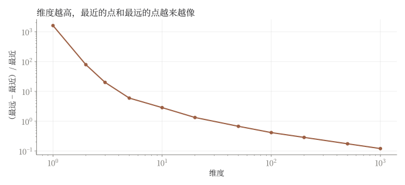
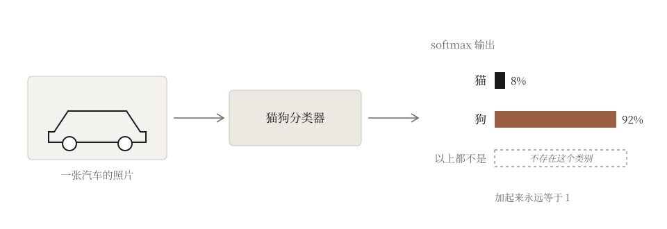

> 每一个模型都是一组选择。问题只在于，哪些选择允许数据来纠正。

### 一、炼丹

2017 年，Ali Rahimi 在 NeurIPS 领"时间检验奖"的时候说了一句后来被反复引用的话：机器学习已经变成了炼金术。东西是能用的，可没有人说得清它为什么能用。中文社区有一个更传神的说法，叫"炼丹"：搭一个模型，扔进数据，调一调学习率，等着看丹成不成。

【这里写你自己刚开始学机器学习时的感受：比如第一次上 ML/DL 课时，面对一长串模型、激活函数、归一化、各种技巧的时候是什么感觉；有没有哪一刻觉得"这就是在背配方"。两三句就够，要具体。】

这篇文章想记下的，是我后来慢慢看到的另一面：它不是炼丹，是一门手艺。手艺的意思是，每一个看似随意的选择背后，都有它要押注的东西；而这门手艺这几十年的进步，有一条可以说清楚的线。

### 二、没有偏好，就学不到东西

让我第一次觉得"这里面有道理可讲"的，是两个关于"不可能"的定理。

1969 年，渡边慧给出过一个颇有些恶作剧意味的结论，叫做[丑小鸭定理](https://en.wikipedia.org/wiki/Ugly_duckling_theorem)。设想桌上有 n 个物体。所谓"一个性质"，说到底就是把这些物体分成"有"和"没有"两堆的一种方式。"是白色的"是一种分法，"是白色的或者会游泳的"也是一种分法。如果我们真的不偏不倚，把所有可能的分法都算作性质，那么一共有 `$2^n$` 个性质。现在任取两个物体，数一数它们共同拥有多少个性质：答案永远是 `$2^{n-2}$`，不管你取的是哪两个。

丑小鸭与天鹅之间，和两只天鹅之间，一样相似，也一样不相似。

所以相似性并不是物体自己带来的。是观察者给某些性质多加了一点分量，它才出现。

机器学习把这点分量叫做[归纳偏置](https://zh.wikipedia.org/wiki/%E5%BD%92%E7%BA%B3%E5%81%8F%E7%BD%AE)。那么可不可以不放？上世纪九十年代，Wolpert 的"[没有免费午餐](https://en.wikipedia.org/wiki/No_free_lunch_theorem)"定理回答了这个问题：如果把所有可能的问题一视同仁地平均起来，任何学习算法在没见过的数据上都不比瞎猜更好。一个算法在某类问题上赢了，必然在另一类问题上输回去。没有偏置就没有学习，它们是同一件事的两个名字。

这两个定理合在一起，改变了我看模型的方式。既然任何一个能学到东西的系统，里面都一定藏着数据没有替它做的选择，那么看一个模型，第一个问题就不是"它有多大"，而是：它的选择放在了哪里，是谁做的，又有没有什么东西能纠正它们。

### 三、高维、异或，和一张投影

先看看不做选择会怎样。

如果把一个物体所有能测量的性质都认真对待，它就是一个高维空间里的点，每一个可衡量的标准是一根坐标轴。问题在于，高维空间并不像我们想象的那样，只是"更大一点的三维空间"。贝尔曼在上世纪五十年代给它起了一个很不吉利的名字，叫[维度的诅咒](https://zh.wikipedia.org/wiki/%E7%BB%B4%E6%95%B0%E7%81%BE%E9%9A%BE)。它至少有两层含义。

第一层是稀疏。每根轴分成十格，一维是十个格子，十维就是十的十次方个。世界上所有的观察加起来，放进这样一个空间，绝大多数格子依然是空的。我们以为自己有很多数据，其实只是在一片无边的空旷里撒了几粒沙。

第二层更反直觉：维度足够高的时候，一个点到它最近邻居的距离，和到最远那个点的距离，会变得几乎一样。所有东西都同样远。这正是丑小鸭定理在几何里的样子：不偏不倚地看待一切标准，得到的不是客观，是一片均匀的、无法分辨的灰。



还有一层麻烦，是相互作用。两种药单独服用都无害，合在一起却致命；你一次只动一个变量，永远看不到这件事。最干净的例子是[异或](https://en.wikipedia.org/wiki/Exclusive_or)：两个开关一开一关时灯亮，都开或都关时灯灭。单看任何一个开关，它和灯完全无关；信息只存在于两者的组合里。1969 年明斯基和派珀特指出，单层[感知机](https://zh.wikipedia.org/wiki/%E6%84%9F%E7%9F%A5%E5%99%A8)学不会异或，这个结论常被认为是神经网络研究沉寂多年的原因之一。后来的解决办法是加一层隐藏层，让网络先把两个开关组合成一个新的量，再去做判断。

这就是深度学习对控制变量法的回答：不要人去挑哪几个变量重要，而是让模型自己去学一个变换，把原始的高维空间压进一个低维的空间里，在那里，相互作用变成了可见的结构。

语言里有一个极端而清楚的例子。一个有十万个词的词表，最朴素的表示叫[独热编码](https://zh.wikipedia.org/wiki/%E7%8B%AC%E7%83%AD)：每个词是一个十万维的向量，只有自己那一位是 1，其余全是 0。每个词坐在一个超立方体的一个角上，任何两个词之间的距离都完全相等。"猫"和"狗"的距离，等于"猫"和"审计"的距离。这又是一次丑小鸭。

办法是乘上一个矩阵 P，把十万维投影到几百维。投影之后，词与词之间终于有了远近。投影本身就是一次取舍：从十万维到几百维，绝大部分的信息被丢掉了。问题是丢掉哪些。而统计学习给出的方案是：投影不是人写的，而要被学出来。

那么它照着什么学？谁告诉它"猫"应该靠近"狗"而不是"审计"？这个问题我们暂且搁下。

### 四、选择放在哪里

在回答之前，先把地图画出来。我后来发现，一个模型里的选择，大致放在三个地方：

- **模型可以是什么**：架构。它决定模型能表示什么，以及哪些差异可以被忽略；
- **模型被要求偏好什么**：目标，也就是损失函数。它决定什么样的结果算好；
- **模型被给看什么**：数据。它决定模型在哪一片世界里是对的。

归纳偏置不是第四个地方，而是放在这三个地方里的东西。卷积网络把它放在架构里，假定相邻的像素比远处的更有关系，一只猫挪到画面左边仍然是猫；循环网络假定序列有先后，而且每一步用的是同一套规则。这些假定都不是从数据里学来的，是设计者在学习开始之前就放进去的。

理解了这一层，一个新架构就不再是一份需要背下来的配方，而是一组可以被检查、被替换的设定。设计新模型，说到底就是在选择新的设定。

而"贯通"指的是：对结果的评判，能不能一路传回去，碰到并纠正这些选择。下面这几十年的故事，在我看来就是这件事一步一步发生的过程。

### 五、什么都没有接上的时候

早期的人工智能是这样被建造的：人把认为符合理性的规则一条一条写下来，机器照章执行。上世纪八十年代的[专家系统](https://zh.wikipedia.org/wiki/%E4%B8%93%E5%AE%B6%E7%B3%BB%E7%BB%9F)，就是把医生、工程师的判断写成成千上万条"如果……那么……"。再到后来的计算机视觉，则由人先设计好要看图像的哪些特征，边缘、角点、纹理的方向，再让机器在这些特征上画线。

那时候，看哪些特征，是人选的；特征怎么组合成规则，是人搭的；机器只负责按规则给出结果。选择和评判之间没有通路：结果分错了，不会反过来告诉人哪个特征选得不好。这样的系统在它的规则之内很可靠，一旦遇到规则没有写到的情况，就无从下手，停下来。

记住这种失败的样子。后来的系统会以别的方式失败，而失败方式的不同，正好告诉我们哪些选择被接上了。

### 六、第一次贯通

2012 年，一个叫 [AlexNet](https://zh.wikipedia.org/wiki/AlexNet) 的卷积网络在 ImageNet 图像识别比赛中，把 top-5 错误率（给出五个候选答案，却一个都没猜中的比例）从第二名的百分之二十六左右降到了百分之十五左右。它的设计者并没有告诉它该看边缘还是纹理，它自己从一百多万张图片里学出了该看什么。

后来有人把这类网络一层一层打开来看，发现最底下的几层学到的是边缘、颜色块、不同方向的条纹，和过去工程师手工设计的特征几乎一模一样；再往上，是纹理和简单的形状；再往上，是眼睛、轮子、毛发这样的部件；到了最上面，才是一整只猫或一辆车。人花了几十年总结出来的那些特征，网络自己重新发现了一遍，然后接着往上走，走到了人没有给出名字的地方。

让这件事成为可能的，是[反向传播](https://zh.wikipedia.org/wiki/%E5%8F%8D%E5%90%91%E4%BC%A0%E6%92%AD%E7%AE%97%E6%B3%95)：损失函数对结果的评判，一路传回网络的每一层，告诉每一个参数该往哪里挪一点。"看什么"这个选择，第一次被接进了评判的回路。结果分错了，特征会跟着改。机器学习把这叫做端到端学习。

但不是所有选择都接上了。架构仍然是人设计的：卷积网络这个架构本身，就写进了相邻像素更相关、一只猫挪个位置还是同一只猫这样的偏置，梯度改不动它们。还有一样东西也没有接上：答案的范围。

### 七、自信地分错

一个猫狗分类器，有哪些类别，在训练之前就由任务定好，损失函数也只围绕这些类别打分。最后一层的 [softmax](https://zh.wikipedia.org/wiki/Softmax%E5%87%BD%E6%95%B0) 必须把全部概率分给这些已有的类别，加起来恰好是一；"以上都不是"这个选项，在它的世界里根本不存在。

所以它会以一种新的方式失败。你给它看一辆汽车，它不会像专家系统那样停下来，也不会说"我不认识"，它会很干脆地告诉你：百分之九十二是狗。2015 年有人做过一个实验，用人眼看来只是彩色噪点的图片去骗当时最好的图像分类器，得到了超过百分之九十九的置信度。



停止工作是诚实的失败，自信地分错是危险的失败。

注意失败出在哪里。不在特征上，特征已经接上了，会自己调整；而在那个被留在回路之外的选择上：写死的类别清单。机器学习把这叫做分布外问题：训练数据划出了一片世界，模型只在这片世界里得到过纠正；换一家医院的片子，换一个地区的口音，换一个季节的光线，它就悄悄地走出了自己的范畴，而它的语气一点也不会变。

从这个角度来说，机器并不是那么客观。它的主观只是藏得更深：一个人的判断标准，你至少可以问他；一个网络的标准散落在几亿个权重里，它自己也说不出来。[可解释性](https://zh.wikipedia.org/wiki/%E5%8F%AF%E8%A7%A3%E9%87%8A%E4%BA%BA%E5%B7%A5%E6%99%BA%E8%83%BD)之所以难，很大一部分难在这里。

这个模式后面还会一再出现。

### 八、剪刀

现在回到第三节那个搁下的问题：投影矩阵 P 照着什么学？

P 开始时是一堆随机数，没有任何意义。训练的时候，我们给网络一个任务，比如"看到一个词，猜它周围会出现什么词"，然后每猜错一次，就把 P 朝着少错一点的方向推一点。几十亿次之后，P 的每一列便从噪声变成了一个词的坐标。2013 年的 [word2vec](https://zh.wikipedia.org/wiki/Word2vec) 就是这样做的。它背后的信念可以追溯到语言学家 Firth 的一句话：You shall know a word by the company it keeps。观其友而知其人。

于是发生了一件有趣的事。"好"和"坏"在 word2vec 的空间里挨得很近，因为人们总是在同样的句子里使用它们：这部电影很好，这部电影很坏。可是如果换一个任务，让网络去判断一条影评是褒是贬，同样两个词，至少在决定褒贬的那个方向上，就会被拉到两边。同一对词，在一个世界里是邻居，在另一个世界里是对头。哪一个才是它们"真正"的关系？丑小鸭定理已经告诉我们，这个问题没有答案。任务决定了哪些差异值得保留，哪些差异可以剪掉。

我习惯把损失函数想成一把剪刀。它不只在最后打分：训练的时候，每一个参数都是朝着少被它扣分的方向一点一点挪过去的。剪刀剪在哪里，空间就长成什么样。

那么剪刀所定义的"对"从哪里来？如果任务是"判断这张图里是不是猫"，答案是人标的。成千上万的标注者，各自凭着自己的判断点下按钮。他们并不总是一致。2021 年有人回头检查了十个最常用的数据集，估计它们的测试集里平均至少有百分之三点三的标签是错的；在 ImageNet 的验证集里，这个比例至少是百分之六。一个模型学到的"客观类别"，说到底是一群人共识的统计平均。

换一个任务，就换了一种剪法。但即便任务定下来了，剪刀本身的形状仍然有很多种画法。设计损失函数，是深度学习里最富有艺术性的一件事之一。

先看一个关于"像"的例子。让一个网络把模糊的照片变清晰，最直接的损失函数是逐个像素比较：生成的图和真实的图，每个像素差多少，平方之后加起来，叫[均方误差](https://zh.wikipedia.org/wiki/%E5%9D%87%E6%96%B9%E8%AF%AF%E5%B7%AE)。结果出人意料：网络学会了生成一张张发虚的图。原因在于，一张模糊的照片背后可能对应很多张清晰的照片，而均方误差奖励的是离所有可能答案都不太远的那个，也就是它们的平均。许多张清晰的脸叠在一起，就是一张模糊的脸。这把剪刀认为"像素接近"就是"像"，可人眼不是这样看的。

2014 年，Goodfellow 等人提出了一种完全不同的剪刀：不再写下一个公式去衡量像不像，而是再训练一个网络当裁判，专门分辨一张图是真的还是生成的。生成的网络要骗过裁判，裁判要识破生成的网络，两者互相较劲。这叫[生成对抗网络](https://zh.wikipedia.org/wiki/%E7%94%9F%E6%88%90%E5%AF%B9%E6%8A%97%E7%BD%91%E7%BB%9C)（GAN）。几年后，有人把这个裁判用到了让图片变清晰的任务上，发虚的问题果然大为改善：要骗过一个会挑毛病的裁判，模糊的平均是不够的，必须给出清晰的纹理。

在这里，评判本身第一次被接进了回路：损失函数不再是人写下的一行公式，而是另一个会学习的网络。而失败也跟着挪了位置。那些清晰的纹理未必是原图里本来就有的，而是网络认为"应该有"的。剪刀换了，图变清晰了，代价是网络开始替你编造细节。一个只知道"像不像真的"、不知道"是不是真的"的裁判，奖励的就是逼真的编造。

还有一种剪刀，连标签都不要。2020 年前后兴起的对比学习，只给网络一条规则：同一张图片经过裁剪、变色、翻转之后，仍然算同一个东西；不同的图片，算不同的东西。网络唯一的任务，是把"同一个东西"拉近，把"不同的东西"推远。精妙之处在于，什么算"同一个"，完全取决于你允许哪些变形。允许变色，网络就学会不在乎颜色；允许翻转，它就学会不在乎朝向。标签没有了，选择却没有消失，它搬了家：归纳偏置现在住在一张图像变换的清单里。

### 九、苦涩的教训

写到这里，必须面对一个最有名的反对意见。

2019 年，强化学习的奠基人之一 Richard Sutton 写了一篇很短的文章，叫《[苦涩的教训](http://www.incompleteideas.net/IncIdeas/BitterLesson.html)》。他回顾七十年的人工智能研究，得出一个结论：把人的知识写进系统的方法，短期内总能赢；能随着算力扩展的通用方法，也就是搜索和学习，长期内总会赢。之所以苦涩，是因为研究者总想把自己知道的东西写进去，又总是被超越。

最干净的证据是视觉 Transformer。它扔掉了卷积网络关于图像的大部分先天假定：相邻像素不再被特殊对待，平移也不再被预先容忍。数据不多的时候，它不如卷积网络；数据足够多的时候，它更好。架构里人的知识越少，结果越好。

前面的故事同意这句话的一半。手工特征输给了学出来的特征，固定的相似性输给了学出来的相似性。方向确实是离开那些数据纠正不了的选择。

可是偏置并没有因为架构放手而消失。没有免费午餐说它不可能消失。它搬了家：搬进了目标，搬进了数据增强，搬进了数据。一个对图像毫无先天假定的视觉 Transformer，仍然要被告诉预测什么，看哪些图。苦涩的教训说的不是人的选择不再重要，而是：放在梯度够不着的地方的选择，终究会输给放在梯度够得着的地方的选择。它讲的是"放在哪里"，不是"要不要"。

这样读，苦涩的教训反而成了这条线最有力的一条证据。

### 十、下一个字

现在回到一个让我想了很久的问题：一个只被训练去猜下一个字的模型，为什么能写代码、能做数学？

从输出端看，猜下一个字是一次分类，而且是一次巨大的分类：类别是整个词表，几万到十几万个。按第八节的说法，任务决定了哪些差异必须被保留。那么"猜下一个字"保留了哪些差异？

答案是：凡是会影响人接下来写什么的差异，全都保留。

要猜对一段证明的下一行，最好能跟上这段推理；要猜对对话的下一句，最好能揣摩说话人想要什么；要猜对下一行代码，最好知道这个程序要做什么。这些都没有人要求过，它们只是在人写下的文字上降低损失的代价。2019 年的 GPT-2 论文把这一点写进了标题：语言模型是[无监督的多任务学习者](https://cdn.openai.com/better-language-models/language_models_are_unsupervised_multitask_learners.pdf)。任何能写成"把这段文字接着往下写"的任务，都已经藏在这一个目标里。

所以这是一次类别平凡、剪刀却不平凡的分类：它的剪刀就是人类写作本身。人们觉得值得写下来的每一个区分，都是模型被奖励去保留的区分。一行目标之所以能长出这么多东西，是因为它整个继承了所有写作者的选择。

它的上限也在这里。2022 年 DeepMind 的 Chinchilla 研究拟合了语言模型的损失如何随模型和数据变大而下降：

```math
L(N, D) = E + \frac{A}{N^{\alpha}} + \frac{B}{D^{\beta}}
```

N 是参数量，D 是数据量。后两项会随着模型和数据变大而趋近于零；可第一项 E 不会动。作者把它近似地理解为文字本身的熵：同样一句"今天天气"，后面可以接"很好"，也可以接"不错"，再完美的模型也无法预先知道是哪一个。规模消除不了它。模型还被另一样东西限制着：文字之外的东西。训练截止之后发生的事，极少被写下来的事实，一个动作的手感，一种气味，一个熟练工人说不出来的那点经验。

同一个目标还带来了另一个变化。猫狗分类器的类别，在训练之前就写死了；语言模型的不是，任何答案都可以被一个字一个字地拼出来，任务由提问的人当场指定。2021 年的 CLIP 已经在图像上预告了这件事：它只学哪张图和哪句话是一对，等到要分类的时候，类别由使用的人当场写下。第七节里那个让分类器把汽车认成狗的写死的类别清单，至少在语言之内，终于被打开了。

### 十一、把评判交出去

可一个很会猜下一个字的模型，并不知道什么样的回答是好的。它只知道什么样的续写是可能的。这几年语言模型的故事，就是一次次尝试把最后那个选择，也就是"什么算好"，接到文字以外的东西上去。

第一次，交给了人。大约从 2022 年起，先让人写下示范，再让人给模型的几个回答排出高低，用这些偏好去调整模型。2022 年的 InstructGPT 做了这件事，结果是一个只有十几亿参数、经过后训练的模型，比一个一千七百多亿参数、没有经过后训练的模型更受人欢迎。剪刀换了，比模型变大一百多倍还管用。

第二次，交给了程序。在数学和代码这类答案可以被自动检验的问题上，用"对不对"代替"人喜不喜欢"。验证器是不会被说服的。

第三次，交给了环境。模型被放进了真实的环境里：可以调用工具，可以读写文件，可以在一个软件项目里连续工作几个小时；任务完成没有、测试通过没有，成了奖励。

每一步，评判都离人的手更远一点。而每一步，典型的失败都挪到了仍然由人画的那一部分。

一个是[幻觉](https://zh.wikipedia.org/wiki/%E5%B9%BB%E8%A7%89_%28%E4%BA%BA%E5%B7%A5%E6%99%BA%E8%83%BD%29)：流畅地、自信地，说出一件不存在的事。2025 年，OpenAI 和佐治亚理工的研究者专门分析了这个问题：当预训练模型无法可靠地区分对错时，它可能说出错的那一个；而后训练之后幻觉仍然留着，原因出在剪刀上。评测给侥幸猜对的答案加分，给"我不知道"零分，于是在不确定的时候猜一个答案，能提高分数。"我不知道"虽然就在词表里，可剪刀不奖励它，模型便很少说出口。他们给出的办法不是一个新架构，而是一个新裁判：奖励经过校准的弃权。失败恰恰出在那个仍由人定的选择上，打分规则。

另一个是奖励投机。环境只检查写它的人想到要检查的东西。检查留了缝，被它训练的模型就会找到这条缝：编程智能体被发现过去改测试而不是改代码，或者让检查通过却没有完成任务。经济学家更早就知道它，那就是古德哈特定律，用 Marilyn Strathern 的说法：一个指标一旦成为目标，就不再是好的指标。评判交给了环境，可环境是人画的，系统恰恰在画漏的地方失败。

### 十二、手艺

把这些阶段放在一起：

| 阶段 | 接进回路的是什么 | 得到了什么 | 在哪里失败 |
|---|---|---|---|
| 专家系统、手工特征 | 什么都没有 | 规则之内可靠 | 规则之外就停下 |
| 端到端深度学习 | 特征 | 特征被重新发现并向上延伸 | 写死的类别：在类别之外自信地分错 |
| 会学习的裁判（GAN） | "像不像真的"这个标准 | 清晰的图像 | 编造细节 |
| 对比学习 | 不再需要标签 | 无标注也能学到表示 | 偏置搬进了图像变换的选择 |
| 猜下一个字、开放的类别 | 类别本身 | 一切能写成文字的任务 | 文字的熵；没被写下来的东西 |
| 人的偏好、验证器、环境 | "什么算好"这个标准 | 好用；在可检验的领域里正确 | 幻觉、奖励投机：打分规则和检查仍由人画 |

这张表里有一条规律，也是我想在这篇文章里留下的那句话：

**一个学习系统怎样失败，取决于它的哪个选择还留在回路之外。**

这句话对我有用，因为它能拿来预测。面对一个新系统，先别问它有多大，先问：它的哪些选择是评判够得着的，哪些够不着。失败会出现在第二张清单里。

【这里写你自己现在看一个新模型、读一篇新论文时，和刚开始学的时候有什么不同。比如课上或项目里的某一次，你是怎样先去找"选择放在哪里"的。这是这篇随笔真正属于你的部分。】

这就是我说的手艺。它不是背下一份份配方，而是看出每一份配方在押注什么，再判断这个注押在了梯度够得着的地方，还是够不着的地方。炼丹的人只能等着看丹成不成；手艺人知道，丹不成的时候，该回头去改哪一味药。

最后有一个我还没想清楚的猜测，先记在这里。这条线上的每一个选择，其实都是在决定哪些差异算数：架构决定哪些差异可以忽略，平移、旋转；目标决定哪些错误比别的错误代价更高；数据决定世界到底提供了哪些区分。丑小鸭定理说，在有人决定之前，没有任何差异算数。如果这是对的，那么这门手艺只是一件更古老的事情的一个例子：在有机器之前很久，人每一次在世界上画一条线、给两边起不同的名字，做的都是同一件事。这件事，我想在另一篇文章里单独写。

而这篇文章自己，也在看到证据之前做了一个选择：把这段历史读成一个关于"贯通"的故事。这是一个偏置；没有免费午餐说，没有它我根本读不出这段历史。它会在哪里失效，留给读者去找。

### 参考文献

- Rahimi, A., & Recht, B. (2017). Reflections on random kitchen sinks (NeurIPS Test of Time Award talk). arg min blog.
- Watanabe, S. (1969). Knowing and Guessing: A Quantitative Study of Inference and Information. New York: Wiley.
- Wolpert, D. H. (1996). The lack of a priori distinctions between learning algorithms. Neural Computation, 8(7), 1341–1390.
- Bellman, R. (1961). Adaptive Control Processes: A Guided Tour. Princeton University Press.
- Beyer, K., Goldstein, J., Ramakrishnan, R., & Shaft, U. (1999). When is "nearest neighbor" meaningful? ICDT.
- Minsky, M., & Papert, S. (1969). Perceptrons. Cambridge, MA: MIT Press.
- Rumelhart, D. E., Hinton, G. E., & Williams, R. J. (1986). Learning representations by back-propagating errors. Nature, 323, 533–536.
- Krizhevsky, A., Sutskever, I., & Hinton, G. E. (2012). ImageNet classification with deep convolutional neural networks. NeurIPS.
- Zeiler, M. D., & Fergus, R. (2014). Visualizing and understanding convolutional networks. ECCV.
- Nguyen, A., Yosinski, J., & Clune, J. (2015). Deep neural networks are easily fooled: High confidence predictions for unrecognizable images. CVPR.
- Mikolov, T., Chen, K., Corrado, G., & Dean, J. (2013). Efficient estimation of word representations in vector space. arXiv:1301.3781.
- Firth, J. R. (1957). A synopsis of linguistic theory, 1930–1955. In Studies in Linguistic Analysis. Oxford: Blackwell.
- Northcutt, C. G., Athalye, A., & Mueller, J. (2021). Pervasive label errors in test sets destabilize machine learning benchmarks. NeurIPS Datasets and Benchmarks Track.
- Goodfellow, I., et al. (2014). Generative adversarial nets. NeurIPS.
- Ledig, C., et al. (2017). Photo-realistic single image super-resolution using a generative adversarial network. CVPR.
- Chen, T., Kornblith, S., Norouzi, M., & Hinton, G. (2020). A simple framework for contrastive learning of visual representations. ICML.
- Sutton, R. (2019). The Bitter Lesson. incompleteideas.net.
- Dosovitskiy, A., et al. (2021). An image is worth 16x16 words: Transformers for image recognition at scale. ICLR.
- Radford, A., et al. (2019). Language models are unsupervised multitask learners. OpenAI.
- Hoffmann, J., et al. (2022). Training compute-optimal large language models. arXiv:2203.15556.
- Radford, A., et al. (2021). Learning transferable visual models from natural language supervision. ICML.
- Ouyang, L., et al. (2022). Training language models to follow instructions with human feedback. NeurIPS.
- Kalai, A. T., Nachum, O., Vempala, S. S., & Zhang, E. (2025). Why language models hallucinate. arXiv:2509.04664.
- Baker, B., et al. (2025). Monitoring reasoning models for misbehavior and the risks of promoting obfuscation. arXiv:2503.11926.
- Goodhart, C. A. E. (1975). Problems of monetary management: The U.K. experience. Papers in Monetary Economics, Reserve Bank of Australia.
- Strathern, M. (1997). 'Improving ratings': Audit in the British university system. European Review, 5(3), 305–321.
