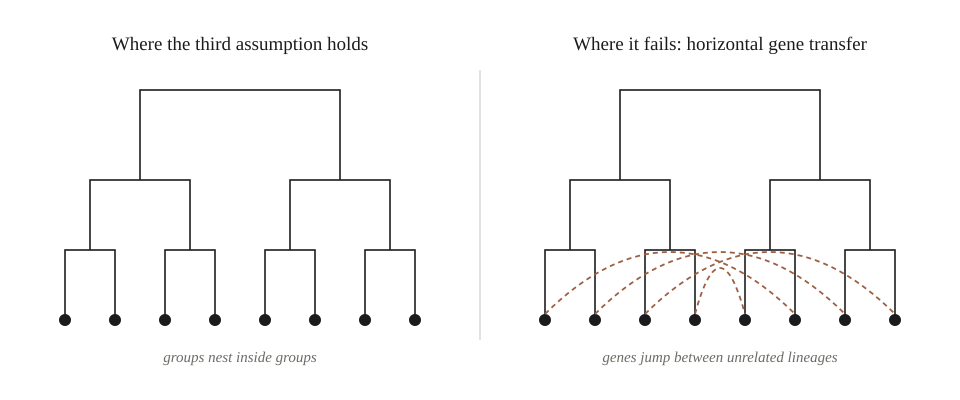
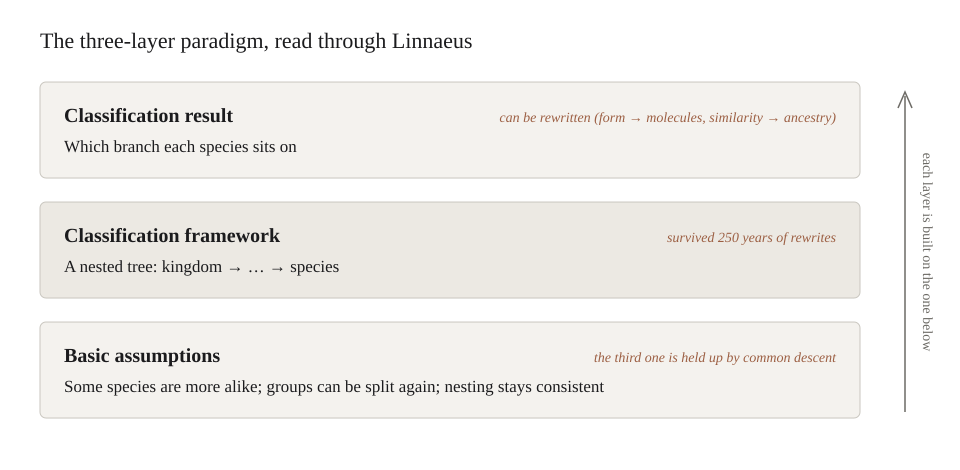
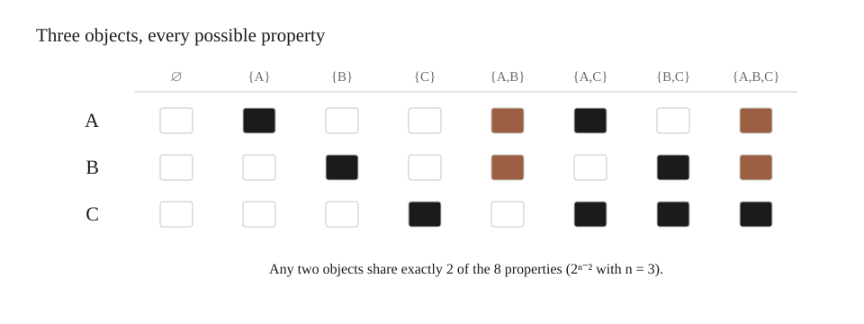

> The way out of many hard problems lies in rethinking how we classify.

## Part One: Classification as a Means of Knowing

### 1. Introduction: Starting from the Classification of Species

A lungfish is more closely related to you than to a tuna. By the standards of modern systematics, "fish" is not a real group at all. And yet the tree that Linnaeus drew to hold the fish is still standing: nearly every branch has been reattached since his time, but the shape has survived.

This essay starts from that small fact. It takes place in biology, but the structure hidden inside it is far more general than biology.

[Carl Linnaeus](https://en.wikipedia.org/wiki/Carl_Linnaeus) began the work of classifying species systematically. In 1735 he published [Systema Naturae](https://en.wikipedia.org/wiki/Systema_Naturae). He had no microscope to look at cells, and no idea that DNA existed. Relying only on observations of form, such as "the number and arrangement of the stamens and pistils," he put similar organisms into the same group, and then, within that group, divided the species that differed into finer groups, like a tree.

What is interesting is that Linnaeus knew perfectly well that this standard was artificial. He counted stamens and pistils not because they best reflected the "true" relations between plants, but because they were simple, easy to count, and easy to identify. He chose a convenient standard, not a correct one.

In this way he arranged all the plants known at the time into a nested system. He used five ranks: kingdom, class, order, genus, species. Later generations filled in phylum and family between them, giving us the "kingdom, phylum, class, order, family, genus, species" that we all memorized at school. His [binomial nomenclature](https://en.wikipedia.org/wiki/Binomial_nomenclature) is still the basis of every scientific name in biology today. A system this large: how much observation, how much summarizing did it take? How many shared traits decided that some things belonged to the same order, and how many differences put them into different families? Just thinking about it is exhausting.

But as history moved on and technology advanced, Linnaeus's standard of classifying by form was gradually adjusted and replaced. Evolutionary biologists today work at the molecular scale. They compare the DNA or protein sequences of different species, and starting from how similar the sequences are, they infer which sequences are [homologous](https://en.wikipedia.org/wiki/Homology_%28biology%29), that is, descended from a common ancestor. Then, using models of how mutations accumulate over time, they convert differences between sequences into evolutionary distances, and from these they reconstruct the tree of relationships among species. The resolution of this method now far exceeds that of traditional morphological classification.

There is a detail here that is easy to miss: homology and similarity are not the same thing. Similarity is a number you can measure. Homology is a judgment about history; it says "these came from the same ancestor." [Molecular systematics](https://en.wikipedia.org/wiki/Molecular_phylogenetics) uses the first to infer the second.

In the 1960s and 70s, this detail set off a dispute inside taxonomy. One school argued that organisms should be grouped by overall similarity: the more alike, the more they belong together. The other argued that grouping should follow common ancestry only: a group must contain an ancestor and all of its descendants. The dispute went on for a long time, and the second school's way of thinking gradually became the mainstream of systematics today. And so some classes we had taken for granted began to loosen. However similar fish are to one another, in strict cladistics "fish" is no longer a legitimate group, because a [lungfish](https://en.wikipedia.org/wiki/Lungfish) is more closely related to a human than to a tuna. The common ancestor of all fish also counts us among its descendants; draw a line around the fish and leave out the humans, and the group is missing a piece. In everyday speech, of course, "fish" is still used.

Later biologists overturned almost all of Linnaeus's classification results. They even replaced the standard for what belongs together: from "similar means same group" to "same ancestor means same group." And yet the binomial nomenclature and the ranked hierarchy survived. In the system Linnaeus built, every "branch" has been reconnected, but the shape of the tree remains.

This means that a system of classification can be refuted in its content and still survive in its form.

What, then, is this form that survived? It is the idea that the relations among species can be represented by a nested tree. And the form of a tree grows out of a few basic assumptions that we take to be "true":

- Some species are more similar to each other, and some differ more (so they can be grouped)
- Within a group, the differences between species are also larger or smaller (so groups can be divided further)
- These relations of similarity are consistent with each other: if A and B are closer to each other than to C, then at a finer level B will not suddenly become closer to C (so the groups nest strictly and never cut across one another)

But Linnaeus was only aware of the first two. He did not know the third. The mechanism that guarantees the third was spelled out by Darwin more than a hundred years later: living things descend with modification, branching off generation after generation from common ancestors. Linnaeus was not drawing a family tree, and his classes were not drawn by ancestry; yet his tree could be drawn so cleanly, for the most part, only because an assumption he did not yet know about happened to be holding it up.

We could say Linnaeus was lucky. But seen from another angle, it may not have been only luck.

A framework that accepts only the first two assumptions cannot actually derive the third. Force any pile of things into a hierarchy and it will always draw you a tree, even if those things have nothing to do with each other. What the framework cannot do is make the tree come out clean everywhere. And what Linnaeus and his successors found was that nature's tree came out surprisingly clean: classes within classes, groups under groups, very rarely crossing. This cleanness itself became a clue. In [On the Origin of Species](https://en.wikipedia.org/wiki/On_the_Origin_of_Species), Darwin explicitly used it as evidence. Why can living things be arranged, of all ways, as "groups subordinate to groups"? Because they come from one family tree.

So rather than saying the framework derived the third assumption, it is better to say the framework made the third assumption visible. Classification ran ahead of explanation.

But if the basic assumptions fail, the shape of the tree changes, and the classification results built on it may vanish. This is not a hypothetical. In bacteria and archaea, genes can pass directly between individuals that are not related at all. This is called [horizontal gene transfer](https://en.wikipedia.org/wiki/Horizontal_gene_transfer). Here the third assumption no longer holds, and so at the microbial end, the "tree of life" looks more like a net.

The story above can be broken down into a three-layer paradigm, and this paradigm will stay with us through the whole essay. The three basic assumptions are the basic assumptions; the hierarchical tree that grows out of them is the classification framework; which branch each species finally sits on is the classification result. When the evidence changed from form to molecules, only the results changed. The change from "similar" to "same ancestor" went one layer deeper: it replaced the criterion by which the framework decides what belongs together, and that is why a class like "fish" could fall. Where such a criterion comes from is a question we will return to in Section 11. Yet even this did not touch the shape of the tree, because the three assumptions still held. With bacteria, the third assumption fails, and the tree itself cannot be kept.

And so we have a starting point:

**Classification results depend on the classification framework, and the classification framework grows out of basic assumptions.**

### 2. A Shared Structure Behind Many Problems: How to Classify

Before going further, I should make clear what this essay means by "classification." By classification I mean cutting a continuous and complicated world into a few parts that can be treated separately, and then making a judgment or taking an action accordingly. Naming a species is classification; deciding which drawer a piece of clothing goes in is also classification.

Once it is defined this way, something interesting appears. Look through the three-layer paradigm given above (classification result, classification framework, basic assumption), and many problems that seem unrelated reveal the same structure. For example:

#### Law

- Classification result: crime or not, this crime or that one; the division of responsibilities and obligations
- Classification framework: the elements of a crime; branches of law such as civil, criminal, and administrative law
- Basic assumptions: no crime without a law; everyone is equal before the law; laws do not apply retroactively

#### Taxation

- Classification result: taxable or exempt, which tax bracket applies, where the threshold lies
- Classification framework: types of income (wages, services, business, property) and progressive tax tables
- Basic assumption: ability to pay; the greater one's capacity to bear the burden, the larger one's share

#### Tidying a room

- Classification result: which drawer, which cabinet each thing goes into
- Classification framework: layers by frequency of use, with things used often kept at hand and things used rarely put up high; zones by where things are used
- Basic assumptions: some things cost more to reach than others; something you just used is likely to be used again soon

#### Writing high-performance programs

- Classification result: whether a piece of data lives in a register, the cache, main memory, or on disk; which code is the hot path and which is the cold path
- Classification framework: the memory hierarchy, where faster storage is smaller and more expensive
- Basic assumption: the [principle of locality](https://en.wikipedia.org/wiki/Locality_of_reference). Data that was just accessed is likely to be accessed again soon, and data that sits next to each other is likely to be accessed together

You may have noticed that tidying a room and writing high-performance programs share the same basic assumption. A person sorting a wardrobe and an engineer tuning a cache are doing the same thing. Brian Christian and Tom Griffiths make this comparison in *Algorithms to Live By*; what the three layers add is the reason it works. The two share a basic assumption, and so they end up with the same framework.

#### Teaching artificial intelligence to generate text

- Classification result: which entry in the vocabulary the next token is
- Classification framework: a vocabulary that cuts text into basic units, and a space, learned by the model, in which every unit has a position
- Basic assumptions: the meaning of a word is determined by the words around it; a piece of text can be predicted one unit at a time, from left to right

This last one deserves an explanation. Seen from the output end, every time a [large language model](https://en.wikipedia.org/wiki/Large_language_model) produces a token, what it does is, quite literally, a classification, and the number of classes is the size of the vocabulary: tens of thousands to over a hundred thousand. When it writes an essay, it has carried out thousands of classifications in a row. This holds only from the output end, of course; how the model represents context inside, and how it combines and reasons, cannot all be called classification. This essay takes only the output end.

None of this means that the answer to every problem is a class. It means that underneath these problems, the same three layers can be found. Things both differ and share something in common; classifying is drawing "lines" between the differences and the commonalities. Which directions the lines are drawn in depends on the basic assumptions; how they are drawn is set by the classification framework; where they finally land is the classification result. Classification is the "subjective" act of placing lines in an objective world, and one of the most basic acts by which humans come to know that world.

The limits of this lens need to be stated plainly. If "classification" could explain everything, it would explain nothing. So this essay holds it to one requirement: the lens is useful only when it lets us see a basic assumption that was hidden, or the same structure in two fields where we had not noticed it, as with tidying a room and caching data. Designing a rocket's trajectory has a curve as its answer, not a class; calling it classification would only rename it, without letting us see anything more. In places like that, the framework of this essay does not apply.

In everything humans do, doing science, building technology, writing, making art, setting policy, we want to get it "right." But "right" itself needs a standard, and a standard is a classification framework: it separates "meets the standard" from "does not." Within such a framework, things can then be divided further.

Our title is "The Subjective Art of Objective Problems." What it is really asking is this:

**Is there a classification that depends on no one's basic assumptions and is decided by the world alone?**

Since classification is the basic act by which people know the world, the extent to which we can find such a classification probably measures the extent to which we can know "the real world." This is almost the state that everyone who pursues science and truth dreams of.

### 3. "Objective Problems": The Trap of Objectivity and the Web of Variables

Suppose such a classification exists. What is the most natural way to look for it? Probably this: favor no standard at all, and take into account everything that can be measured. That seems to be what "objective" means.

A person who pursues "objectivity" in this way will soon realize that classification has become something he can neither understand nor carry out. By that standard, an object has an endless list of measurable, observable properties: dimension, density, velocity, acceleration, time... The list has no end. Does color count? Does smell count? Does its place in someone's memory count?

These variables usually act all together to produce the appearance of reality. At first we thought we could hold all the other standards fixed and study only one changing factor, to understand how appearances relate to causes. But as the number of variables grows, this method often seems to stop working. Variables are usually not independent points; they are linked to one another in a huge web, and a change in one variable can, at any moment, set off unpredictable effects in the others.

Which variables are unrelated to the rest and can stand as a class of their own? It seems impossible to decide.

But without deciding, there is no classification. If every connection is kept, the world can only be one whole web, and no class can be separated out.

So instead of imagining classification as setting up a row of boxes, it is better to imagine it as a pair of scissors. The world was a web to begin with, with links of different thickness between its points; classification is cutting some of the links in this web, so that what remains draws together into clusters. Which links, then, should be cut?

In the picture of a web, the "drawing lines" we spoke of in Section 2 means cutting every link that crosses the line. Classification inevitably cuts away some connections that objectively exist and keeps only part of them: the part that is useful for knowing, and that the group accepts.

Notice the phrase "the group accepts." It says that whoever holds the scissors decides what the web finally looks like; and the one holding the scissors is never a single person, but the habits and "rules" a group of people has agreed on.

Back to the question from Section 2. We wanted to find a classification decided by the world alone, and the most direct way was to consider everything impartially. But everything has no end, and it is all entangled; without cutting, nothing can be separated, and once the scissors come down, where to cut is no longer something the world decides for us.

At least along this road, we will not find that kind of classification. This is the trap of objectivity: we think that making no choice is being objective, but making no choice separates nothing at all.

### 4. "Subjective Art": Where to Draw the Line

Back to the scissors.

To classify, we have to sacrifice or ignore some of a point's connections. Raise the threshold of similarity, and cut away whatever falls short of it. Linnaeus's threshold was the number of stamens; a library's threshold is the academic discipline; a toddler's threshold might be "will it bite me?"

And the person pursuing objectivity will realize again that choosing such a threshold seems to have no justification; it is set by people. And if people set it, isn't it still colored by subjectivity?

Since cutting is unavoidable, surely at least where we cut can be objective? For instance, cut by similarity: the more alike things are, the closer together they go, and once they are similar enough, they form a class. Similarity is surely a property of the things themselves?

This sounds very reasonable. Unfortunately, it too has been proven wrong.

### Interlude: The Ugly Duckling

In 1969, Satosi Watanabe gave a result with a slightly mischievous flavor, called the [ugly duckling theorem](https://en.wikipedia.org/wiki/Ugly_duckling_theorem).

Imagine n objects on a table. A "property," in the end, is just a way of splitting these objects into two piles: those that have it and those that do not. "Is white" is one way of splitting; "is white or can swim" is another. If we are truly impartial and count every possible way of splitting as a property, there are `$2^n$` properties in all. Now pick any two objects and count how many properties they share. The answer is always `$2^{n-2}$`, no matter which two you pick.

The ugly duckling and a swan are exactly as similar, and exactly as dissimilar, as two swans.

The same gray appears in geometry. Describe an object by every property you can measure, so that it becomes a point in a space with thousands of dimensions, and as the dimensions grow, the distance from a point to its nearest neighbor and to its farthest become almost the same. Everything is equally far away. Treat every standard impartially and what you get is not objectivity, but an even, indistinguishable gray.

So similarity is not something objects bring with them. It appears only when an observer gives a little more weight to some properties.

Machine learning calls this weight [inductive bias](https://en.wikipedia.org/wiki/Inductive_bias). A [convolutional network](https://en.wikipedia.org/wiki/Convolutional_neural_network) assumes that neighboring pixels are more related than distant ones, and that a cat moved to the left of the frame is still a cat; a [recurrent network](https://en.wikipedia.org/wiki/Recurrent_neural_network) assumes that a sequence has an order, and that the same rule applies at every step. None of these assumptions is learned from data. The designer puts them in before learning begins.

Could we leave them out? In the 1990s, Wolpert's ["no free lunch" theorem](https://en.wikipedia.org/wiki/No_free_lunch_theorem) answered this. If you average over all possible problems, treating them all as equal, no learning algorithm does better than random guessing on data it has not seen. If an algorithm wins on one kind of problem, it must lose it back on another. Without bias there is no learning; they are two names for the same thing.

A bias is a category. Within its category, a category can do anything; outside its category, it can do nothing. It marks out a world in which things make sense, and within that world learning is possible; step outside, and it guarantees nothing.

At this point, classification and "objectivity" part ways.

### 5. Good Classification Keeps the Subjective: The Nature of Knowing the World

As the title says, "the subjective art of objective problems." The existence of nature is not bound by human will, but how nature comes to be known is bound by human cognition.

At the end of the last section we said that classification and "objectivity" part ways. Philosophers noticed this long ago. People often say "this falls outside the category of what we are discussing," meaning that judging a question rests on certain standards and premises, which is exactly what basic assumptions and classification frameworks look like. Aristotle wrote [the Categories](https://en.wikipedia.org/wiki/Categories_%28Aristotle%29), an attempt to list the few basic kinds that we cannot avoid whenever we talk about anything. Two thousand years later, [Kant](https://en.wikipedia.org/wiki/Immanuel_Kant) pushed the idea further: categories are not properties of the world itself, but a framework that human reason already carries before it knows the world, and experience can only be known within these frameworks.

The power of a category and its weakness come together: within its category, a category can do anything; outside its category, it can do nothing.

The cleanest example comes from geometry. [Euclid's fifth postulate](https://en.wikipedia.org/wiki/Parallel_postulate) says that through a point not on a line there is exactly one line parallel to it. From this assumption the whole framework of Euclidean geometry is built, and from it come results such as the angles of a triangle adding up to one hundred and eighty degrees. Within Euclidean geometry, this result holds absolutely; it can do anything. But in the nineteenth century mathematicians kept the other axioms and replaced only the fifth postulate, assuming that more than one parallel line could be drawn, or none at all, and obtained geometries in which the angles of a triangle add up to less than one hundred and eighty degrees, and to more, and these geometries are just as consistent as Euclid's. The old result can do nothing in the new category. Later, the curved geometry of spacetime that Einstein used to describe gravity grew out of exactly this [non-Euclidean](https://en.wikipedia.org/wiki/Non-Euclidean_geometry) line. Non-Euclidean geometry did not prove Euclidean geometry wrong; it only showed where Euclidean geometry holds. Physics finally chose non-Euclidean geometry to describe gravity not because it is more "objective," but because its assumptions suit that problem better. Good classification does not eliminate the subjective; it is simply clear about what its assumptions are, and where they will fail.

"Subjective" here must be kept apart from "arbitrary." Where to cut is not wherever one pleases. It is constrained by at least three things: purpose, that is, what the division is for; cost, that is, how much a wrong division will cost; and the world itself. That Linnaeus's tree could be drawn so cleanly, that non-Euclidean geometry could describe gravity: these are the world answering. Assumptions are proposed by people, but tested by the world. So when this essay calls classification subjective, it means that classification cannot be separated from the observer's purposes and choices, not that it can be anything at all. As for "the group accepts," that is the part of these choices that has survived testing among many people.

This middle position is not new. Hilary Putnam's internal realism and Nelson Goodman's *Ways of Worldmaking* each held, in their own terms, that our conceptual schemes are ours, and yet that not anything goes. What this essay tries to add is not the position, but a way of locating it layer by layer: which choice sits in which layer, and where the world pushes back.

Basic assumption, classification framework, classification result. In geometry and in biology, this three-layer paradigm has the same shape. It will come back several times later, each time wearing a different face.

### 6. Machines That Classify

The clearest place to watch these layers at work today is machine learning, and I have followed it in detail in a [companion essay](/post.html#where-the-choices-went). Here I take only what the rest of this essay needs.

Early artificial intelligence was built entirely by hand. The [expert systems](https://en.wikipedia.org/wiki/Expert_system) of the 1980s wrote down thousands of "if... then..." rules: people chose what to look at, people chose how observations combined, and the machine carried the rules out. Such a system was reliable inside its rules, and when it met a case the rules did not cover, it stopped.

Deep learning changed the relationship among the layers. From 2012 on, networks such as [AlexNet](https://en.wikipedia.org/wiki/AlexNet) learned for themselves what to look at, because the judgment of the result, the loss, could now travel back through every layer of the network and correct it. The basic assumptions stayed in human hands, built into the architecture; the framework was filled in by data.

But the shape of the results stayed in human hands too. A cat-and-dog classifier must divide all its confidence between cat and dog; "neither" does not exist in its world. Show it a car and it does not stop, as an expert system would. It says, without hesitation, that this is 92 percent dog. Stopping is an honest failure. Classifying wrongly and confidently is a dangerous one. Outside its category, a category can do nothing; only it does not know that it can do nothing.

From this angle the machine is not so objective. Its subjectivity is just hidden deeper, scattered across millions of weights, where it cannot tell you what it chose. Perhaps the boundary between humans and artificial intelligence lies not in who is more rational, but in who knows better where their own scissors are.

### 7. The Language Model: Who Holds the Scissors?

A large language model looks, at first, as if it has escaped this trap. Its training goal is not a fixed classification but guessing the next token, and that is a classification whose scissors are human writing itself: every distinction people found worth putting into words is one the model is rewarded for keeping. Its classes are no longer written in advance; whoever asks decides what to divide. In 2025, prompted to play a persona, GPT-4.5 was judged to be the human in a three-party [Turing test](https://en.wikipedia.org/wiki/Turing_test) 73 percent of the time. Within the category of language, the line between human and machine can no longer be drawn. Whether it exists outside language is another matter, and how "intelligence" itself should be defined is yet another classification problem.

Since then, the judgment of a good answer has been handed over one pair of scissors at a time: from human rankings, to programs that check whether a proof or a piece of code is right, to whole environments that reward finishing a task. This year AI produced results on some long-open mathematical problems that come with machine-checkable formal proofs; the step of judging right from wrong really has been handed to a program that cannot be persuaded.

Yet the failures follow the scissors. Language models still state falsehoods fluently, and a 2025 analysis by researchers at OpenAI and Georgia Tech traced this to the scoring: evaluations give points for a lucky guess and nothing for "I don't know," so the model learns to guess. Their remedy was a new judge, one that rewards calibrated abstention. And where an environment's checks leave a gap, models trained against it find the gap, editing the tests instead of fixing the code. When a measure becomes a target, it ceases to be a good measure.

The rule that runs through all of this: **the layer left in human hands decides how a system will fail.** The scissors have left human hands, but their shape is still drawn by people.

### Summary of Part One

Taking the act of classifying as our starting point, we drew out the three layers behind it: basic assumption, classification framework, classification result. We saw that considering everything impartially separates nothing; that similarity appears only when an observer gives some properties more weight; that good classification does not remove the subjective but is clear about where its assumptions will fail; and, in machines, that the layer left in human hands decides how a system will fail.

In the second half, we ask where this kind of cognition reaches its limit, where its assumptions come from, what comes before it, and what kind of cognition grows what kind of intelligence.

## Part Two: The Limits of Classification, the Limits of Cognition

### 8. The Limit Above Classification

At the end of Part One, we saw what a certain kind of model looks like: its task is decided on the spot by whoever asks, and it no longer needs a classification set up in advance for any particular task.

This is worth looking at again from another angle. A cat-and-dog classifier has a fixed classification because its training goal is classification itself: the results are fixed as cat and dog, and the loss function judges everything around those two classes. A large language model's training goal is not any particular classification; it is guessing the next token. Once the training goal changed from a fixed classification to guessing the next token, "classifying by task" no longer had to be written into training, and could be left until the question was asked. This is exactly the connection of the three layers from Section 6: when one layer changes, the change travels along the path and pulls on the other two.

But classification did not disappear because of this; it only retreated to a lower layer. At every step the model chooses from its vocabulary, and the vocabulary was fixed before training. It can say infinitely many sentences, but every one of them is spelled out from those tens of thousands to a hundred-odd thousand tokens; what is not in the vocabulary, it cannot spell at all. The classification at the level of tasks has been opened up, but the classification at the level of tokens is sealed shut.

So this model looks as if it has no boundary, but in fact it has an upper limit. It is just that the limit does not lie in the results; it lies in the basic assumptions: in the smallest units it is allowed to use, and in the assumption that "everything can be written down as text."

This leads to a bigger question. If every classification has its upper limit, is there a largest class, big enough to hold every classification, with no class bigger than it?

People who pursue objectivity would probably like such a class. Find it, and every classification becomes a subclass beneath it, and the whole world is caught in one net.

Start from the simplest place. Section 2 said that classification is cutting the world into a few pieces that can be treated separately. A class that contains everything has nothing outside it; it is not distinguished from anything, and so it separates nothing. If there is only one class, how can that be called classifying? This is the first difficulty of the upper limit: the bigger a class is, the less it can tell us; once it is big enough to contain everything, it says nothing at all.

Mathematics has given a sharper answer to this question.

In 1891, [Cantor](https://en.wikipedia.org/wiki/Cantor%27s_theorem) proved the following: take any set, and gather together all of its subsets, that is, every possible way of picking out part of it; the number of these will always be greater than the number of things in the original set. Even if the original set is infinite, its ways of picking form a larger infinity.

It needs to be clear what "a way of dividing" means here. Picking out part of a collection is one division: pick out the white ones, pick out the ones that can swim, pick out the ones that are white or can swim. The ugly duckling theorem in the Interlude used exactly this meaning: n objects have `$2^n$` ways of being picked. Cantor's result is that `$2^n$` is always greater than n, and this stays true even at infinity.

Mathematics is talking about sets; carrying this over to classification is an analogy of mine, not a direct consequence of the theorem. But the direction of the analogy is clear. Suppose there really were a largest class, with everything in it. Then the ways of dividing what is inside it would outnumber the class itself, and it could not hold them. Above it, there is always something bigger.

Later, following Cantor's line of thought, Russell found a [famous paradox](https://en.wikipedia.org/wiki/Russell%27s_paradox): if any property at all may gather up a set, then the set of all sets that do not contain themselves contradicts itself, whether we say it contains itself or not. This forced mathematicians to lay down new rules for what a "set" is, and to stop letting any property gather up a set freely. In the set theory used today, "the totality of all sets" is not a set, or else Cantor's theorem would break it: it would have more subsets than members, yet those subsets are themselves sets and should all be inside it. It can only be called a "class," which can no longer be handled freely like an ordinary set. Within its own domain, mathematics gives a blunt answer: such a largest set does not exist.

This points in the same direction as the conclusion of Part One. The Interlude said that if you prefer nothing, you can separate nothing; here, wanting a class that holds everything also separates nothing, and it cannot even stand up logically. The trap of objectivity cannot be escaped from the end of "considering everything," and it cannot be escaped from the end of "containing everything" either.

Back to that model. Its upper limit is drawn by its basic assumptions; and this section tells us that no form of cognition can have an upper limit that holds everything.

How far, then, can cognition go at most? Can it become as large as the world itself?

### 9. The Map and the Territory

[Borges](https://en.wikipedia.org/wiki/Jorge_Luis_Borges) wrote [a piece only one paragraph long](https://en.wikipedia.org/wiki/On_Exactitude_in_Science). The cartographers of an empire perfected their craft until they drew a map as large as the empire itself, coinciding with the territory point for point. Later generations found the map useless and abandoned it in the desert to the sun and the winds.

That map is what a cognition that wants to hold everything finally looks like.

People who pursue objectivity have probably all had this wish: that one day our knowledge of the world will be complete enough to coincide with the world itself, with nothing left out and nothing cut away, the subjective and the objective becoming one.

That map tells us where this wish ends. A map as large as the territory did not become a better map; it simply stopped being a map. In the same way, a cognition that gives up nothing does not become a better cognition; it simply stops being cognition. Cognition is useful precisely because it is smaller than the world.

So the "cannot" here is not a matter of ability. It is not that we are not yet clever enough, or that machines are not yet big enough; it is that this cannot be done by definition. The limit of the three-layer paradigm is written into its own first step: to classify, you must give something up; to give something up, you cannot have everything.

Then take a step back. Even if we cannot hold everything, could we at least have a complete set of basic assumptions, from which everything true in the world could be derived?

In 1931, [Gödel](https://en.wikipedia.org/wiki/G%C3%B6del%27s_incompleteness_theorems) gave a negative answer. He proved that in any formal system that is strong enough and consistent, there are true statements that the system itself cannot prove. You can add such a statement as a new axiom, but the new system you get will have statements of its own that it cannot prove. Interestingly, the argument he used is of the same kind as Cantor's in the last section: both make a system confront itself.

In this essay's terms: basic assumptions can always be extended, but they can never be closed.

Gödel's result is often stretched very far, for example to prove that the human mind must beat any machine. That is another matter, and I will not touch it here. It is about formal systems; carrying it over to cognition in general is, as in the last section, only an analogy. We take only its plainest meaning: no set of assumptions can settle things once and for all, and this is equally true of humans and machines.

But although a map cannot be as large as the territory, it can be drawn very accurately. The scale is reduced, but the mountains are still where the mountains are, and the rivers where the rivers are. If cognition cannot be the same as the world, can it at least be a faithful stand-in for it?

In 2024, researchers proposed a fascinating hypothesis called the Platonic representation hypothesis. They observed that the bigger and stronger AI models become, the more similar their internal representations of the world become: models with different architectures, models with different training goals, even one model that only sees images and another that only reads text, are slowly converging. Their explanation is that all these models are approaching the same thing, the reality that produces all of our observations. The shadows on the [wall of the cave](https://en.wikipedia.org/wiki/Allegory_of_the_cave) are all different, but there is only one form casting them.

If this is true, it is almost a map drawn separately by many hands that grows more alike the more it is drawn.

But what these models take in is not reality itself. It is text that people wrote and photos that people took. Text already contained "fish" and "tree"; the frame of a photograph had already decided for them what was worth seeing. Russian treats light blue and dark blue as two different basic colors, while some languages do not even separate blue from green; the spectrum itself is continuous, and where it is cut is decided by the people who speak a language.

And so the phrase from Section 3 comes back again: the group accepts. Only this time the group is all of humanity, who wrote the internet. The map that the models draw more and more alike: how much of it is the world as it is, and how much is humanity's shared habit of dividing up the world?

I do not think this question can be answered at present. To separate "the world as it is" from "the way we divide it," we would need material that had passed through no observer at all. And such material, by definition, does not exist.

The map may be accurate. But we can only check it against another map.

### 10. The Source of Classification: Where Do Assumptions Come From?

Almost everything discussed in Part One took place within a given set of basic assumptions: once the assumptions are set, how the framework is built and how the results come out. But where do the assumptions themselves come from? And how do they change?

The last section said that basic assumptions can always be extended but never closed. The sentence can also be read the other way: since they can never be closed, one form that progress in cognition will always take is extending the assumptions.

Human history is, in a sense, a history of classification. Learning a new way of classifying often means finding a new thing that can be measured, and discovering that yet another variable exists.

In 1869, [Mendeleev](https://en.wikipedia.org/wiki/Dmitri_Mendeleev) arranged the known elements into a table by atomic weight. The table had two odd features. He left gaps for elements that had not yet been discovered, and in a few places he deliberately broke the order of atomic weights, for example putting tellurium before iodine, simply because tellurium's properties fit that group better. His classification was already pointing to something deeper than atomic weight, but he could not name it. More than forty years later, [Moseley](https://en.wikipedia.org/wiki/Henry_Moseley) measured [atomic numbers](https://en.wikipedia.org/wiki/Atomic_number) with X-rays, and only then was that variable finally seen.

This has the same shape as the story of Linnaeus and Darwin in Section 1: classification ran ahead of explanation.

The later story of botany goes the other way. For more than two hundred years after Linnaeus, plants were grouped mainly by the look of their flowers, fruits, leaves, and stems. In the 1990s, DNA sequences became a new thing that could be measured, and the families and orders of flowering plants were redrawn in large numbers as a result. "Tree" turned out not to be a group at all: being tall, woody, and having a trunk is a way of growing that has appeared independently in many unrelated lineages, and some trees are closer relatives of roadside weeds than of other trees. The variable arrived first, and classification had to be rewritten.

With Mendeleev, classification led and the variable caught up; in botany, the variable came first and classification followed. The two stories say the same thing: behind a class there often stands a variable that has not yet been named. And once it is found, what gets rewritten is not just the classification results, but the basic assumptions themselves.

The fifth postulate that was replaced, back in Section 5, was also such a moment. It did not make Euclidean geometry more precise; it replaced the foundation of the whole of geometry.

I think the greatest advances in human cognition have probably all been moments like this: not dividing more finely and more accurately within one set of assumptions, but finding a new variable and replacing an old assumption. Thomas Kuhn called such moments paradigm shifts, and this section owes him the idea; what the three layers add is a way to say which layer a shift has reached.

What about artificial intelligence?

It can already do, within given assumptions, things that people have never done. In 2017, DeepMind's [AlphaGo Zero](https://en.wikipedia.org/wiki/AlphaGo_Zero), without having seen a single human game, knowing only the rules of Go and what counts as winning, played millions of games against itself and came up with many moves that humans had not played in thousands of years. The mathematical results mentioned in Section 7 are the same: within given axioms, proving theorems that people have not proved.

But the rules were given by people, what counts as winning was decided by people, and the axioms were written down by people. It found paths through a house that no one had walked before, but the house was built by people.

The other kind of thing it has not yet clearly done: build a new house of its own. To look at a pile of data, as Mendeleev did, and see a variable no one can name, and get later generations to accept it; to propose a new axiom, as the mathematicians who replaced the fifth postulate did, and open up a new world.

Value judgments are the hardest kind. "[No crime without a law](https://en.wikipedia.org/wiki/Nulla_poena_sine_lege)," "taxation by ability to pay": no one wrote these assumptions down one day. They grew bit by bit through long social life, and were accepted by one generation after another. Today's models can of course say "no crime without a law," but that was put in by people through training, and it is a different thing from growing a norm of its own through its dealings with the world and with others.

So the real line between humans and artificial intelligence may lie not in who calculates faster or remembers more, but here: whether one can go from "creating within the assumptions" to "creating new assumptions."

This line is itself a classification, and it should be held to the same standard as every other one in this essay. AlphaGo's famous move 37 against Lee Sedol in 2016: was it a new path through an old house, or the first brick of a new one? Within the rules of Go, it was a path. But AlphaGo's games went on to change opening theory among professional players, and for them, something closer to an assumption was rewritten. Which side of the line the move falls on depends on whose assumptions we are watching. So the line cannot be drawn by inspecting the machine alone; it can only be drawn by what happens afterward.

Under some combination of compute, preferences, structure, and standards of judgment, could a machine also take the road that humans have taken, and grow new variables, new languages, new norms of its own?

I do not know. Probably no one knows yet. I only want to make clear what we should expect to see if one day it does: not a higher score on old questions, but a new assumption that it proposes, one that makes humans understand anew something they thought they already understood. Like those few gaps in Mendeleev's table. Those gaps counted because they could be tested: gallium, scandium, and germanium were later found one by one, with properties close to what he had predicted. A new assumption must likewise be handed to the world to test, and then accepted by many people, before it truly counts as a new house.

If it holds for both humans and machines that assumptions can never be closed, then even if there is a race between them, it is not a race to see who breaks through this limit first, because no one can. It is a race about who is better at rewriting assumptions, and it has no finish line.

### 11. Before Classification

Having come this far, there is a question I cannot get around: if classification is the basic act of cognition, is there anything more fundamental than classification?

The question is a bit of a loop. Answering "what is more fundamental than classification" is itself ranking concepts, which is to say, classifying once again. It seems we have no way to stand outside the three-layer paradigm to answer it, because the act of asking is already inside the paradigm. Section 8 said that no class can hold all classifications; likewise here, there is no position from which we can stand entirely outside classification.

But the way out may be in words we have already written. When Section 2 defined classification, it said: cutting a continuous and complicated world into a few parts that can be treated separately, and then making a judgment or taking an action accordingly.

"And then making a judgment or taking an action accordingly": we have been passing over the second half of that sentence all along.

Classification is never the end point. Linnaeus counted only stamens and pistils because what he wanted was easy identification; an engineer treats air as incompressible at low speeds because there, calculating quickly matters more than calculating precisely; people decide what counts as a good result for a model because they want it to do something. Before every act of classification stands a "for what."

What comes before classification is purpose.

This may be the most precise meaning of the word "subjective" in the title. The world gives us endless differences; that is objective. Which of them we care about depends on what we want to do; that is subjective. The subjective art of objective problems, in the end, is first being clear about what for, and then deciding how to divide.

But purpose does not make classification arbitrary. Section 5 said that where to cut is constrained by three things, and purpose is only the first; cost and the world itself are still there. Purpose decides which differences we care about; the world decides whether those differences can bear the judgments we want to make. Linnaeus wanted easy identification, and stamens are indeed easy to count; but once people's purpose became explaining kinship, the world sent that way of dividing back, and classification was later rewritten by kinship. Purpose itself is rewritten in the same way: when a purpose cannot bear the judgments it wants, people change the purpose, or change the way of dividing.

Some people hold that the most fundamental thing in cognition is prediction, or compression. I do not think this conflicts with what I have said. Prediction cannot do without classification; as Section 2 said, every time a language model predicts a token, it classifies. Compression depends on classification even more: to compress is to decide which differences can be dropped. And what to predict, and what to compress away, comes back to purpose.

So this section's answer is: beneath classification, there is nothing more "objective" waiting for us; but in front of classification, there is something more "subjective" that has been there all along.

### 12. What Kind of Cognition, What Kind of Intelligence

The last question is also the question of the title itself: what kind of cognitive means grows what kind of intelligence? If we want a general intelligence, what kind of cognition does it need?

First we have to ask what "general" means.

If it means doing well on every possible problem, then the Interlude gave the answer long ago: there is no free lunch. The theorem says that if all possible problems are averaged together as equals, no learner does better than any other, and so none does better than guessing. It speaks only of that average; it does not say that learning in the real world is futile. But if "general" means exactly that kind of equal treatment, then an absolutely general intelligence, like the class that holds everything and the map as large as the territory, does not exist by definition. This step is my reading, not a conclusion of the theorem itself.

So "general" can only be relative: relative to the world we live in, relative to the problems we care about. But which problems count and which do not is again a division made by people, and what it rests on is exactly the purpose of the last section. Section 7 said that how "intelligence" itself should be defined is yet another classification problem. Here its meaning becomes clearer: the definition of general intelligence has its own basic assumptions, its own framework, and its own standards of judgment.

On this premise, we can reason backward about what such an intelligence probably needs.

First, it must be able to change how it divides things according to the problem. The task cannot be fixed into it; what classes to divide into should be decided by the problem to be solved. Today's large language models already do this to a considerable degree.

Second, it must know where its own category ends. When it walks past the boundary, it should be able to say "I don't know," rather than confidently giving a wrong answer. The classifier in Section 6 that took a car for a dog, and the fluent hallucination in Section 7, both failed on this point. Today's machines manage it only partly.

Third, it must be able to rewrite its assumptions: to find a variable no one can name, propose a new axiom, grow a new norm. This is the line from Section 10.

There is one more thing I want to talk about here: intuition.

A grand concept can rarely be made clear by language alone. We can interpret it from every angle, but what finally stays in the mind is usually not any one definition, but a whole picture of it. That picture is intuition.

Intuition is not the unreliable subjective feeling people often take it to be. Someone who has played chess for thirty years cannot say why a move is good, yet knows it is good; a doctor who has read tens of thousands of scans cannot state the rules, yet sees at a glance what is wrong. They are doing the same thing: pressing a great deal of experience into a picture in the mind, and then reading judgments directly off that picture. Intuition is not the opposite of reason; it is compressed experience.

But clearing intuition's name is not the same as worshipping it. Since intuition grows out of experience, it carries that experience's preferences, and so it has its own outside-the-category. The mistakes made by the classifier in Section 6 can be found in human intuition too.

Absolute objectivity, perhaps, exists only in honest uncertainty. Before making a judgment, a person usually holds not one answer but several possibilities, each with its own weight: seventy percent it looks like this, thirty percent like that. But the moment one says out loud "it is this," the thirty percent is erased, and there is no longer any difference between seventy and a hundred. Where the evidence has not yet settled the matter, the moment of giving a certain answer is the moment of making a choice. Objectivity does not require certainty; it requires that what the evidence has not yet decided is not decided by us on its behalf. The uncertainty must be honest, of course, and dishonesty can go in two directions: calling seventy a hundred is one, calling seventy a fifty-fifty is the other. Nor does uncertainty by itself guarantee objectivity: if the seventy came from biased experience, then however honestly it is stated, it is only honestly wrong.

This is really the same as the second point. Knowing where your category ends comes down to knowing how much uncertainty you still have, and being willing to say so. Machine learning calls one half of this calibration: across many comparable judgments, the cases where a model says it is seventy percent sure should turn out right about seventy percent of the time. The hallucination paper from Section 7 proposed exactly this remedy: reward calibrated abstention. Calibration is not the same as knowing one's boundary, of course: a model well calibrated on familiar problems can still fail outside the distribution. But it is at least the part of this ability that can be measured. So the second ability is nothing mysterious; it has a clear technical meaning. Today's standards of judgment simply do not reward it enough.

Putting all this together, I think the answer this essay can finally give is this:

What is worth pursuing is not an intelligence without categories. Sections 8 and 9 have already shown that such a thing does not exist. What is worth pursuing is an intelligence that knows where its categories lie, and that, when necessary, can rewrite them.

Section 5 said that good classification does not eliminate the subjective; it is simply clear about what its assumptions are, and where they will fail. Section 6 said that perhaps the boundary between humans and artificial intelligence lies not in who is more rational, but in who knows better where their own scissors are. These two sentences describe the same kind of intelligence. It is true for humans, and probably true for machines as well.

No cognition has an upper limit that holds everything. A good intelligence does not need to hold everything either; it only needs to know where its upper limit is, and, when needed, to push it out a little further.

### References

*Main works referred to in the text, listed roughly in order of appearance.*

- Linnaeus, C. (1735). Systema Naturae. Leiden.
- Darwin, C. (1859). On the Origin of Species. London: John Murray.
- Hennig, W. (1966). Phylogenetic Systematics. Urbana: University of Illinois Press.
- Angiosperm Phylogeny Group (1998). An ordinal classification for the families of flowering plants. Annals of the Missouri Botanical Garden, 85, 531–553.
- Christian, B., & Griffiths, T. (2016). Algorithms to Live By: The Computer Science of Human Decisions. New York: Henry Holt.
- Bellman, R. (1961). Adaptive Control Processes: A Guided Tour. Princeton University Press.
- Beyer, K., Goldstein, J., Ramakrishnan, R., & Shaft, U. (1999). When is "nearest neighbor" meaningful? International Conference on Database Theory (ICDT).
- Minsky, M., & Papert, S. (1969). Perceptrons. Cambridge, MA: MIT Press.
- Watanabe, S. (1969). Knowing and Guessing: A Quantitative Study of Inference and Information. New York: Wiley.
- Wolpert, D. H. (1996). The lack of a priori distinctions between learning algorithms. Neural Computation, 8(7), 1341–1390.
- Aristotle. Categories.
- Kant, I. (1781). Kritik der reinen Vernunft [Critique of Pure Reason].
- Goodman, N. (1978). Ways of Worldmaking. Indianapolis: Hackett.
- Putnam, H. (1981). Reason, Truth and History. Cambridge University Press.
- Krizhevsky, A., Sutskever, I., & Hinton, G. E. (2012). ImageNet classification with deep convolutional neural networks. Advances in Neural Information Processing Systems (NeurIPS).
- Zeiler, M. D., & Fergus, R. (2014). Visualizing and understanding convolutional networks. European Conference on Computer Vision (ECCV).
- Nguyen, A., Yosinski, J., & Clune, J. (2015). Deep neural networks are easily fooled: High confidence predictions for unrecognizable images. IEEE Conference on Computer Vision and Pattern Recognition (CVPR).
- Mikolov, T., Chen, K., Corrado, G., & Dean, J. (2013). Efficient estimation of word representations in vector space. arXiv:1301.3781.
- Firth, J. R. (1957). A synopsis of linguistic theory, 1930–1955. In Studies in Linguistic Analysis. Oxford: Blackwell.
- Northcutt, C. G., Athalye, A., & Mueller, J. (2021). Pervasive label errors in test sets destabilize machine learning benchmarks. NeurIPS Datasets and Benchmarks Track.
- Goodfellow, I., et al. (2014). Generative adversarial nets. Advances in Neural Information Processing Systems (NeurIPS).
- Ledig, C., et al. (2017). Photo-realistic single image super-resolution using a generative adversarial network. IEEE Conference on Computer Vision and Pattern Recognition (CVPR).
- Chen, T., Kornblith, S., Norouzi, M., & Hinton, G. (2020). A simple framework for contrastive learning of visual representations. International Conference on Machine Learning (ICML).
- Kaplan, J., et al. (2020). Scaling laws for neural language models. arXiv:2001.08361.
- Hoffmann, J., et al. (2022). Training compute-optimal large language models. arXiv:2203.15556.
- Radford, A., et al. (2021). Learning transferable visual models from natural language supervision. International Conference on Machine Learning (ICML).
- Turing, A. M. (1950). Computing machinery and intelligence. Mind, 59(236), 433–460.
- Jones, C. R., & Bergen, B. K. (2025). Large language models pass the Turing test. arXiv:2503.23674.
- Ouyang, L., et al. (2022). Training language models to follow instructions with human feedback. Advances in Neural Information Processing Systems (NeurIPS).
- Baker, B., et al. (2025). Monitoring reasoning models for misbehavior and the risks of promoting obfuscation. arXiv:2503.11926.
- Goodhart, C. A. E. (1975). Problems of monetary management: The U.K. experience. Papers in Monetary Economics, Reserve Bank of Australia.
- Strathern, M. (1997). 'Improving ratings': Audit in the British university system. European Review, 5(3), 305–321.
- Kalai, A. T., Nachum, O., Vempala, S. S., & Zhang, E. (2025). Why language models hallucinate. arXiv:2509.04664.
- Altman, S. (2025, October 29). Post on X describing OpenAI's internal goals for an automated AI research intern (September 2026) and an automated AI researcher (March 2028).
- OpenAI (2026, May 20). An OpenAI model has disproved a central conjecture in discrete geometry. [openai.com](http://openai.com).
- Cantor, G. (1891). Über eine elementare Frage der Mannigfaltigkeitslehre. Jahresbericht der Deutschen Mathematiker-Vereinigung, 1, 75–78.
- Russell, B. (1903). The Principles of Mathematics. Cambridge University Press.
- Gödel, K. (1931). Über formal unentscheidbare Sätze der Principia Mathematica und verwandter Systeme I. Monatshefte für Mathematik und Physik, 38, 173–198.
- Borges, J. L. (1946). Del rigor en la ciencia [On Exactitude in Science].
- Huh, M., Cheung, B., Wang, T., & Isola, P. (2024). The Platonic representation hypothesis. International Conference on Machine Learning (ICML).
- Berlin, B., & Kay, P. (1969). Basic Color Terms: Their Universality and Evolution. University of California Press.
- Winawer, J., et al. (2007). Russian blues reveal effects of language on color discrimination. Proceedings of the National Academy of Sciences, 104(19), 7780–7785.
- Mendeleev, D. (1869). The relation between the properties and atomic weights of the elements. Journal of the Russian Chemical Society, 1, 60–77.
- Moseley, H. G. J. (1913). The high-frequency spectra of the elements. Philosophical Magazine, 26, 1024–1034.
- Kuhn, T. S. (1962). The Structure of Scientific Revolutions. University of Chicago Press.
- Silver, D., et al. (2016). Mastering the game of Go with deep neural networks and tree search. Nature, 529, 484–489.
- Silver, D., et al. (2017). Mastering the game of Go without human knowledge. Nature, 550, 354–359.
